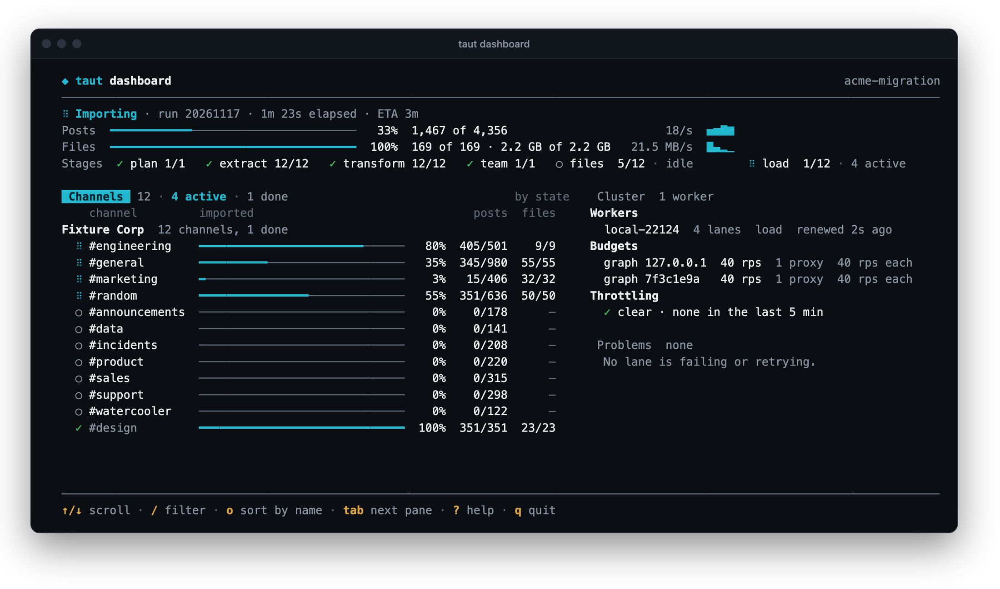
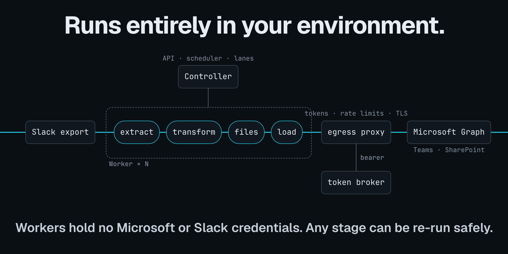
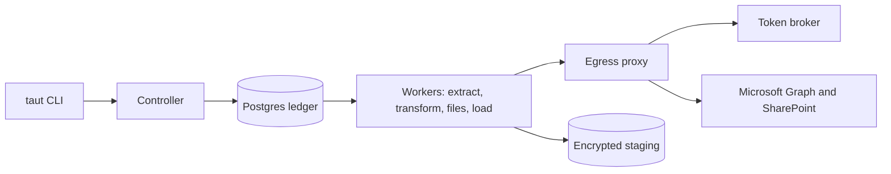
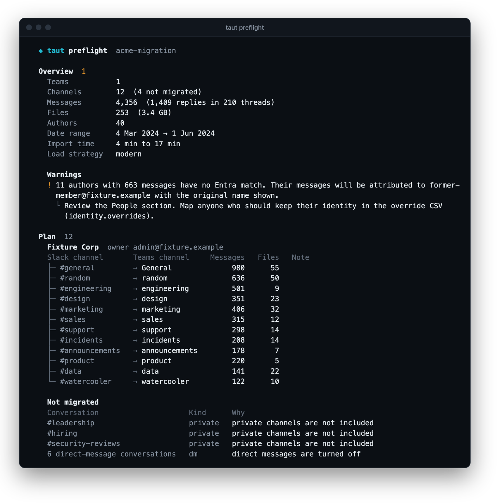
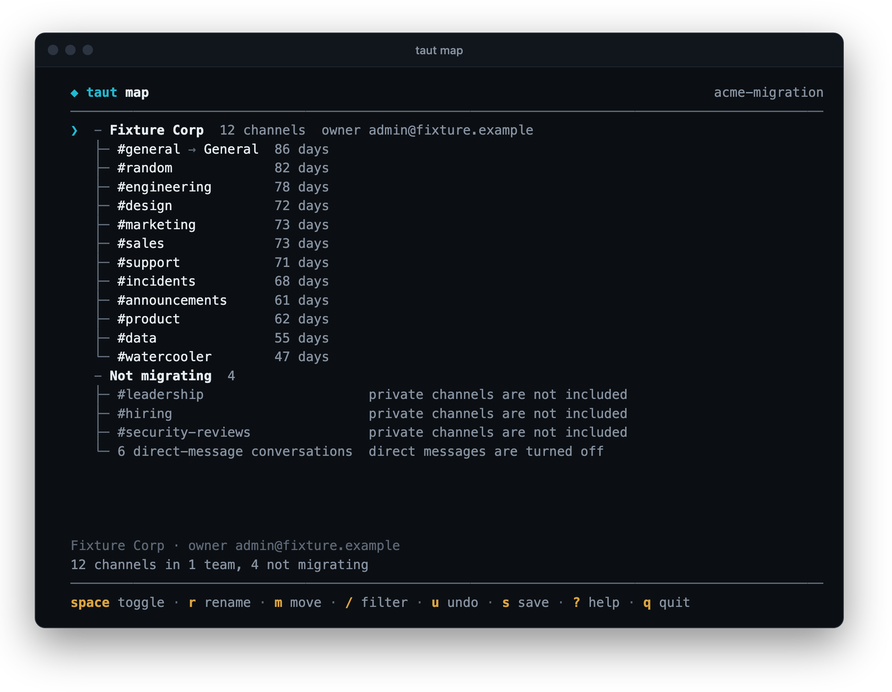

# Taut

<p align="center">
  
</p>

Taut migrates Slack workspaces into Microsoft Teams: channels, threads,
files and people, with original authors and timestamps.

It is free and open source ([Apache 2.0](LICENSE)) and self-hosted. Your
export, your tenant and your credentials stay in your environment and never
pass through anyone else's service. It exists because the migration tooling
built into Microsoft 365 leaves teams with little control over what moves,
when, and how failures are handled. Taut is meant to be something an
engineer can read, run, resume and audit.

> [!WARNING]
> **Taut has not been run against a real Microsoft tenant.** Everything
> below is verified against fake Microsoft and Slack services that ship in
> this repository (`internal/fakegraph`, `internal/fakeslack`). It is not
> production-ready. Rehearse against a non-production tenant before you
> rely on it, and please [report what you find](CONTRIBUTING.md).

## Status

What works, against the fakes:

- Messages, threads and files migrate end to end with `taut migrate`.
- A run can be interrupted at any point and resumed. No message is imported
  twice.
- Workers hold no Microsoft or Slack credentials.
- `taut finalize` opens the channels and adds members.
- `taut map`, `taut dashboard` and `taut audit` cover planning, watching
  and auditing.
- A Helm chart deploys it on Kubernetes. The chart is linted, rendered and
  schema-validated. It has not been applied to a cluster.

Built, and equally untested on a real tenant:

- Private channels: created, imported and opened to their members.
- The `legacy` load strategy for the national clouds.
- Direct messages and group DMs, imported into Teams chats. Off by default.
- Local mode: the whole migration in one `taut` process on the operator's
  machine, for small workspaces. Same ledger, same guarantees; without the
  process isolation of credentials that a cluster has.
- Incremental passes: `taut migrate --incremental` imports, from a newer
  export, only what was added since, including new replies to threads that
  were migrated earlier. It works before and after `taut finalize`.
- Reactions imported as Teams reactions from the people who gave them
  (`content.reactions: native`). Off by default: they are summarized in a
  line of text unless asked for.

What is still open is listed under
[Known limitations](docs/migration-guide.md#known-limitations).

## How it works

<p align="center">
  
</p>



- **The controller** plans the run and serves the API the CLI uses. It
  writes nothing to Slack or Teams.
- **Workers** claim work from a ledger in Postgres. Each channel is
  imported by one worker at a time, in order, under a lease.
- **The egress proxy** is the only way out of a worker pod. It attaches
  tokens, enforces rate budgets shared across all workers, and backs every
  worker off together when Microsoft throttles.
- **The token broker** is the only process that reads the Entra credential
  and the Slack token.
- **Staging** is any S3-compatible bucket. Taut encrypts everything before
  upload.

Microsoft Graph has no idempotency key for imports, and an app cannot
delete a message it imported. Taut leans on one thing Graph does enforce:
it refuses a second message with the same millisecond timestamp in a
channel. Every message is given a unique timestamp before anything is
written. If a worker dies after Graph accepted a message and before
recording it, the retry is refused as a duplicate, and Taut reads the
existing message back and adopts it. Every write lands in a hash-chained
audit log that `taut migrate` verifies before reporting success.

The full account, with diagrams, is in
[docs/how-it-works.md](docs/how-it-works.md).

## Quick start

Requires Go. The Go toolchain version in `go.mod` is fetched automatically.

The shortest way to see a whole migration is **local mode**: one `taut`
process does everything, with nothing to deploy. This runs init, preflight,
migrate, an incremental pass from a later export, finalize and audit
verification against a fixture export and local fakes. Nothing leaves your
machine.

```bash
make local-demo
```

Local mode keeps its ledger in a PostgreSQL server that `taut` starts and
stops itself, so it needs PostgreSQL 14 or newer installed
(`brew install postgresql@17`, `apt install postgresql`). If you have none,
this lets `taut` download one, 15 to 30 MB from Maven Central, into your
user cache directory:

```bash
TAUT_DEMO_DOWNLOAD_POSTGRES=1 make local-demo
```

`make local-demo KILL=1` also kills `taut migrate` part-way with `SIGKILL`
and resumes it. For a real workspace of a few dozen people, local mode is
`taut init --local` and then the usual commands; see
[Local mode](docs/migration-guide.md#local-mode).

### The full stack

A large migration runs on a cluster: many workers, and credentials held by
a process of their own. The rest of this section needs Docker.

Run `init`, `auth` and `preflight` against a fixture export and local
fakes.

```bash
make demo
```

Start the whole stack locally: Postgres, NATS, encrypted object storage,
fake Microsoft and Slack services, the controller, and two workers each
with its token broker and egress proxy.

```bash
make up
```

Import the fixture through it.

```bash
make migrate-demo
```

Run it again while worker and egress proxy containers are killed mid-run,
and check that every message is in the fake tenant once.

```bash
make kill-test
```

Stop the stack and remove its volumes.

```bash
make down
```

> [!TIP]
> `make finalize-demo` continues through `taut finalize` and audit
> verification. `make dms-demo` does the same with direct messages turned
> on, and needs a fresh `make up`.

## Commands

| Command | What it does |
|---|---|
| `taut init` | Guided wizard that writes a config file |
| `taut auth` | Verify Slack and Microsoft credentials; granted against required permissions |
| `taut preflight` | Counts, mapping, unmapped people, unsupported content, time estimate |
| `taut map` | Review and edit the Slack to Teams mapping: include, exclude, rename, move |
| `taut migrate` | Run or resume the migration; safe to interrupt at any point |
| `taut status` | Where the current run stands |
| `taut dashboard` | Live dashboard: progress, workers, rate budgets, throttling, problems |
| `taut finalize` | Complete migration mode, add members, delete staging |
| `taut audit` | Search, browse, verify and export the audit trail |
| `taut doctor` | Environment and connectivity diagnostics |

<p align="center">
  
  
</p>

Every command works three ways:

- **On a terminal:** interactive and keyboard-first, with a help bar.
  <kbd>?</kbd> shows all keys.
- **Piped, or with `--yes`:** plain text, no prompts.
- **With `--json`:** one JSON document on stdout.

Exit codes are stable: `0` success, `1` failure, `2` usage error, `3`
preflight found blockers, `4` a permission or scope is missing.

Flags, sample output and environment variables are in
[docs/cli.md](docs/cli.md).

## A real migration

The short version. The [migration guide](docs/migration-guide.md) has each
step in full, with the permissions Taut needs and why.

1. Create the Entra app registration with `./scripts/entra-app.sh`. It
   needs an administrator who can grant consent.
2. Create a Slack app from the manifest `taut auth --slack-manifest`
   prints, and install it in the workspace.
3. Export the workspace from Slack: Admin → Workspace settings → Security
   → Import & export data → Export tab.
4. Write the config file with `taut init`. It holds references to secrets,
   never the secrets.
5. Check with `taut auth` and `taut preflight`. Adjust with `taut map`.
6. Run `taut migrate`.
7. Check the result in Teams, then run `taut finalize`.

8. If people kept using Slack meanwhile, export again and run
   `taut migrate --incremental` to add what is new. See
   [Migrating in passes](docs/migration-guide.md#migrating-in-passes).

> [!CAUTION]
> `taut finalize` opens the channels to their members, which cannot be
> taken back. Afterwards, more can be imported into a channel only by an
> incremental pass, which locks it again while it runs.

## Performance

`make load-test` imports a generated export of any size through the local
stack and reports how fast it went, what limited it and whether the result
is correct. Results from one laptop, against the fake Graph:

| Run | Result |
|---|---|
| 1,000,000 messages, no limits, 4 workers | Complete and correct in 12 min 2 s |
| 120,000 messages, Microsoft's documented limits, 2 workers | 40 messages a second at best over 30 s, and no 429 from Graph |

Under real limits the duration of a migration is the larger of
`messages / 40 s` and `largest channel / 5 s`. Adding workers beyond the
handful that covers the budget changes neither. The profiles, the full
results and what they cannot tell are in
[docs/LOADTEST.md](docs/LOADTEST.md).

## Documentation

| Page | What it covers |
|---|---|
| [How Taut works](docs/how-it-works.md) | The parts, the pipeline, resume without duplicates, rate budgets, the security model |
| [Migration guide](docs/migration-guide.md) | Permissions, the steps, private channels, direct messages, finalizing, known limitations |
| [Command reference](docs/cli.md) | Every command and flag, output modes, exit codes, environment variables |
| [Configuration](docs/configuration.md) | The `taut.yaml` schema, with an annotated example |
| [Operations](docs/OPERATIONS.md) | Running on Kubernetes with the Helm chart |
| [Load test](docs/LOADTEST.md) | How to run it, and the results |
| [Design notes](docs/design-notes.md) | Why it is built this way |

## Development

```bash
make help
```

| Target | Does |
|---|---|
| `make build` | Build `bin/taut` |
| `make test` | Unit tests with the race detector |
| `make test-all` | Everything, including the kill-and-resume import tests. Starts Postgres, S3 and NATS. The local-mode tests use an installed PostgreSQL, or download one. |
| `make local-demo` | A whole migration in local mode against the fakes, with no Docker |
| `make lint` | golangci-lint |
| `make golden` | Rewrite snapshot files after an intended UI change |
| `make fixtures` | Generate the fixture exports: small, medium, nasty, and the later exports of small and medium |
| `make image` | Build the container image |
| `make helm-lint` | Lint and render the Helm chart and assert its pod security properties |

The terminal UI's colors, spacing, borders and glyphs are all defined in
one file, [internal/tui/theme/tokens.go](internal/tui/theme/tokens.go).

## Contributing

Contributions are welcome, and the most useful one right now is a report
from a run against a real tenant. [CONTRIBUTING.md](CONTRIBUTING.md) covers
setup, what a change needs before it can be merged, and how to report
without exposing real data. Everyone taking part is expected to follow the
[code of conduct](CODE_OF_CONDUCT.md).

## Security

Do not report security problems in public issues.
[SECURITY.md](SECURITY.md) explains how to report one privately and what is
in scope.

## License

Taut is licensed under the [Apache License 2.0](LICENSE).

Taut is an independent project and is not affiliated with, endorsed by or
sponsored by Microsoft or Slack. It is provided without warranty: test a
migration against a non-production tenant before running it for real.
