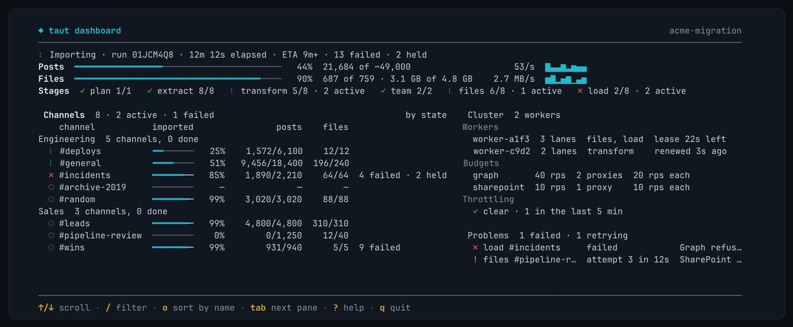

# Command reference

After reading this page you will know what each `taut` command does, which
flags it takes, what it prints in each output mode, and which exit codes and
environment variables a script can rely on.

The sample output on this page comes from the binary run against the
fixture export and the fake services in this repository (`make demo`), and
from the snapshot files the test suite compares against.

**Contents**

- [Overview](#overview)
- [Output modes](#output-modes)
- [Exit codes](#exit-codes)
- [Global flags](#global-flags)
- [Environment variables](#environment-variables)
- [taut init](#taut-init)
- [taut auth](#taut-auth)
- [taut preflight](#taut-preflight)
- [taut map](#taut-map)
- [taut migrate](#taut-migrate)
- [taut status](#taut-status)
- [taut dashboard](#taut-dashboard)
- [taut finalize](#taut-finalize)
- [taut audit](#taut-audit)
- [taut doctor](#taut-doctor)
- [Service commands](#service-commands)

## Overview

| Command | What it does | Needs the controller | Writes |
|---|---|---|---|
| [`taut init`](#taut-init) | Writes a config file with a guided wizard | No | `taut.yaml` |
| [`taut auth`](#taut-auth) | Verifies Slack and Microsoft credentials; granted against required permissions | No | Nothing |
| [`taut preflight`](#taut-preflight) | Counts, mapping, unmapped people, unsupported content, time estimate | No | Nothing |
| [`taut map`](#taut-map) | Reviews and edits the Slack to Teams mapping | No | The channel selection in `taut.yaml` |
| [`taut migrate`](#taut-migrate) | Runs or resumes the migration | Yes | Teams, SharePoint |
| [`taut status`](#taut-status) | Shows where the current run stands | Yes | Nothing |
| [`taut dashboard`](#taut-dashboard) | Live dashboard of the run | Yes | Nothing, except retrying failed lanes on request |
| [`taut finalize`](#taut-finalize) | Completes migration mode, adds members, deletes staging | Yes | Teams |
| [`taut audit`](#taut-audit) | Searches, verifies and exports the audit trail | Yes | An export file, if asked |
| [`taut doctor`](#taut-doctor) | Environment and connectivity diagnostics | No | Nothing |

The usual order is `init`, `auth`, `preflight`, `migrate`, `finalize`.

```bash
taut --help
```

## Output modes

Every command works three ways.

| Mode | When | Behavior |
|---|---|---|
| Interactive | stdout is a terminal | Keyboard-first screens with a help bar. <kbd>?</kbd> lists all keys. |
| Plain | Piped, or with `--yes` | Plain text, no prompts, no cursor movement. One line per finished stage, and a heartbeat every 15 seconds on long steps. |
| JSON | `--json` | Exactly one JSON document on stdout. `taut audit --json` is the exception: one JSON object per line. |

Every error has the same three parts in every mode: what happened, why, and
the next step.

```text
  ✗ No config file found at taut.yaml
    the file does not exist
    └ Run taut init to create one, or pass --config <path>.
```

```json
{
  "error": {
    "code": "config.not_found",
    "what": "No config file found at taut.yaml",
    "why": "the file does not exist",
    "next": "Run `taut init` to create one, or pass --config <path>."
  }
}
```

The `code` is stable. Scripts may match on it.

Keys shared by every interactive screen:

| Key | Action |
|---|---|
| <kbd>?</kbd> | Help: every key on this screen |
| <kbd>q</kbd> | Quit |
| <kbd>Esc</kbd> | Back |
| <kbd>/</kbd> | Filter |
| <kbd>↑</kbd> <kbd>↓</kbd> or <kbd>k</kbd> <kbd>j</kbd> | Move |
| <kbd>PgUp</kbd> <kbd>PgDn</kbd>, <kbd>g</kbd> <kbd>G</kbd> | Page; top and bottom |
| <kbd>Enter</kbd> | Open |

## Exit codes

| Code | Meaning |
|---|---|
| `0` | Success |
| `1` | Failure |
| `2` | Usage error: a bad flag, a missing or invalid config file |
| `3` | `preflight` found blockers. Also `map`, when edits leave a blocker. |
| `4` | A required permission or scope is missing |

## Global flags

| Flag | Meaning |
|---|---|
| `-c`, `--config` | Path to the config file. Default `taut.yaml`. |
| `--json` | Print one JSON document instead of styled output |
| `-y`, `--yes` | Never prompt; accept defaults |
| `--no-color` | Disable color |
| `-v`, `--verbose` | Include diagnostic detail |
| `--version` | Print the version |
| `-h`, `--help` | Help for the command |

## Environment variables

Read by the CLI on the operator's machine:

| Variable | Purpose |
|---|---|
| `TAUT_CONTROLLER_TOKEN` | The controller's API token, for `migrate`, `status`, `dashboard`, `finalize` and `audit` |
| `TAUT_SLACK_TOKEN` | The Slack bot token, if the config file references it by this name (the default) |
| `TAUT_S3_ACCESS_KEY`, `TAUT_S3_SECRET_KEY`, `TAUT_STAGING_KEY` | The names the default config file uses for its staging references |
| `NO_COLOR` | Disables color, like `--no-color` |
| `TAUT_THEME` | `light` or `dark`. Pins the palette. |
| `TAUT_GLYPHS` | `ascii` avoids Unicode symbols; `unicode` forces them |
| `COLORFGBG` | Used as a hint for light or dark when `TAUT_THEME` is not set |

The names of secret variables are your choice. The config file says which
variable or file holds each secret; see
[configuration.md](configuration.md#secret-references).

> [!NOTE]
> Taut never asks the terminal for its background color before printing.
> One-shot output on a light terminal that does not export `COLORFGBG` uses
> the dark palette. Set `TAUT_THEME=light`. The reason is in the
> [design notes](design-notes.md#no-terminal-background-query-at-startup).

The controller, workers and sidecars are configured through environment
variables as well. The Helm chart and the Compose file set them; see
[Service commands](#service-commands).

## taut init

Writes a config file. On a terminal it asks a few questions. With `--yes`,
or when piped, it builds the file from flags alone.

The config file never contains secrets. Where a credential is needed, `init`
asks for the name of an environment variable or the path of a file, and
rejects a secret pasted in its place.

```bash
taut init
```

```bash
taut init --yes --name acme --export ./export.zip \
  --tenant-id <guid> --client-id <guid> --cert-file ./taut-app.pem \
  --team Acme --owner admin@acme.com --unmapped-account former@acme.com
```

| Flag | Meaning |
|---|---|
| `--name` | Migration name: lowercase letters, digits, hyphens |
| `--export` | Path to the Slack export ZIP or extracted folder |
| `--tenant-id` | Microsoft Entra tenant ID |
| `--client-id` | Application (client) ID of the app registration |
| `--cert-file` | PEM file with the app's certificate and private key. Default `./taut-app.pem`. |
| `--client-secret-env` | Environment variable that holds a client secret, instead of a certificate |
| `--team` | Name of the team to create |
| `--owner` | User principal name of the team owner |
| `--unmapped-policy` | `former-member`, `service-account` or `block`. Default `former-member`. |
| `--unmapped-account` | User principal name that unmapped authors are attributed to |
| `--slack-token-env` | Environment variable that holds the Slack token. Default `TAUT_SLACK_TOKEN`. |
| `--no-slack-api` | Read from the export only |
| `--include-private` | Include private channels |
| `--include-direct-messages` | Import direct messages and group DMs into Teams chats |
| `--force` | Overwrite an existing config file |

<details>
<summary>Sample output</summary>

```text
  ✓ Wrote ./taut.yaml
  ! target.entra.credential.clientSecret: a client secret works, but a
    certificate is preferred: it cannot be replayed if intercepted. Switch to
    certificate: { file: … } when you can

  Secrets to set before the next step
    Slack token           env TAUT_SLACK_TOKEN
    Entra client secret   env TAUT_ENTRA_CLIENT_SECRET

  Next  taut auth  verify credentials and permissions
```

</details>

## taut auth

Connects to Slack and Microsoft Entra with the credentials the config file
references and compares what each granted against what Taut needs. Read-only.

Granted Graph permissions are read from the access token's `roles` claim,
and Slack scopes from the `x-oauth-scopes` response header, so `auth` needs
no extra privileges to report gaps.

```bash
taut auth
```

```bash
taut auth --json | jq '.checks[] | select(.status == "failed")'
```

```bash
taut auth --slack-manifest > slack-app.yaml
```

| Flag | Meaning |
|---|---|
| `--slack-manifest` | Print the Slack app manifest that grants the scopes Taut needs |

Exits `0` when everything required is in place, `4` when a permission or
scope is missing, `1` for any other failure.

<details>
<summary>Sample output</summary>

```text
  ◆ taut auth  fixture-medium

  Slack
    ✓ Token found     env TAUT_SLACK_TOKEN
    ✓ Token accepted  fixture-corp workspace, bot token
    ✓ Scopes          8 of 8 required granted

  Microsoft Entra
    ! Credential   client secret (a certificate is safer)
      └ Prefer a certificate: run scripts/entra-app.sh, then set
        target.entra.credential.certificate in the config file.
    ✓ Signed in    tenant 7f3c1e9a-52d4-4b1e-9a57-0c8f2d6e4b10, global cloud
    ✓ Permissions  8 of 8 required granted
    ✓ Directory    Fixture Corp

  ! Passed with 1 warning · 6 passed · 0.1s

  Next  taut preflight  check what will and won't migrate
```

</details>

A passing check is one line. The rows beneath it appear when one needs
attention, or with `--verbose`.

## taut preflight

Checks the migration before anything is written. It reads the Slack export
and the Entra directory and reports channel and message counts, how each
channel maps to Teams, who cannot be mapped, which content Teams cannot
import and what Taut does with it, and how long the import will take.
Strictly read-only.

```bash
taut preflight
```

```bash
taut preflight --json > preflight.json
```

```bash
taut preflight --offline
```

```bash
taut preflight --fail-on warnings
```

| Flag | Meaning |
|---|---|
| `--offline` | Analyze the export only; do not contact Microsoft |
| `--fail-on` | Exit non-zero on `blockers` (default) or `warnings` |

Exits `0` when the migration is ready and `3` when something must be fixed
first. On a terminal the report is a tabbed screen: Overview, Plan, People,
Content, Estimate, Permissions.

<details>
<summary>Sample output (plain mode, abridged)</summary>

```text
  ◆ taut preflight  fixture-medium

  Overview  1
    Teams           1
    Channels        12  (4 not migrated)
    Messages        4,356  (1,409 replies in 210 threads)
    Files           253  (3.4 GB)
    Authors         40
    Date range      4 Mar 2024 → 1 Jun 2024
    Import time     4 min to 17 min
    Load strategy   modern

    Warnings
    ! 11 authors with 663 messages have no Entra match. Their messages will be
      attributed to former-member@fixture.example with the original name shown.
      └ Review the People section. Map anyone who should keep their identity in
        the override CSV (identity.overrides).

  Plan  12
    Fixture Corp  owner admin@fixture.example
    Slack channel       Teams channel     Messages   Files   Note
    ├─ #general         → General              980      55
    ├─ #random          → random               636      50
    ├─ #engineering     → engineering          501       9
    ├─ #design          → design               351      23
    ...
    └─ #watercooler     → watercooler          122      10

    Not migrated
    Conversation                     Kind      Why
    #leadership                      private   private channels are not included
    #hiring                          private   private channels are not included
    #security-reviews                private   private channels are not included
    6 direct-message conversations   dm        direct messages are turned off

  People  11
    Slack users           40
    Matched by email      29
    Matched by override   0
    Unmapped              11  (663 messages affected)
    Policy                attribute to former-member@fixture.example, original name kept in the message

    Unmapped
    Name        Slack email                     Messages   Why
    Grace       grace.fofana@partner.example         166   external or guest
    Tara        tara.quigley@fixture.example         105   email not in Entra
    pagerbot    ○                                     42   bot or app
    Hana        hana.ivanov@fixture.example           23   deactivated in Slack
    ...

  Content  5
    Microsoft Graph cannot import everything Slack stores. This is what Taut
    found and what it will do with each.

    ● 294  Messages with reactions
           Summarized in a line under the message (whether imported reactions
           show in Teams is unconfirmed)

    ! 119  Edited messages
           Final text is imported with an "edited" marker; edit history is not
           available

    ● 102  Bot and app messages
           Attributed to the placeholder account with the bot's name shown

    ● 157  @here / @channel / @everyone
           Converted to plain text so the import notifies nobody

    !  12  Join, leave and topic notices
           Not migrated

    ● transformed   ! information is lost

  Estimate
    Posts to import               4,356
    At 5 requests/s per channel   4 min
    At 1 request/s per channel    17 min
    Limited by                    the largest channel, #general (980 posts)
    Files to stage                3.4 GB

  Permissions
    ✓ Teamwork.Migrate.All         Migration mode and importing messages with o…
    ✓ User.Read.All                Identity mapping: matching Slack users to En…
    ✓ Team.Create                  Creating teams (modern strategy)
    ✓ Channel.Create               Creating channels (modern strategy)
    ✓ TeamMember.ReadWrite.All     Adding owners and members at taut finalize
    ✓ ChannelMessage.Read.All      Reading imported messages back, to resume wi…
    ✓ Files.ReadWrite.All          Creating channel folders and uploading small…
    ✓ Sites.ReadWrite.All          Uploading large files in resumable sessions
    ○ ChannelMember.ReadWrite.All  not needed for this config file
    ○ Chat.Create                  not needed for this config file
    ○ Chat.ReadBasic.All           not needed for this config file
    ○ Chat.Read.All                not needed for this config file
    ✓ Organization.Read.All        Showing the tenant name and verified domains…
    ✓ Team.ReadBasic.All           Detecting team name collisions in taut prefl…
    ✓ Channel.ReadBasic.All        Detecting channel name collisions in taut pr…

  ! Ready, with 1 warning · 12 channels · 4,356 messages · about 17 min to import

  Next  taut migrate  run the migration
```

</details>

With direct messages on, `--json` lists each conversation by its Slack ID,
kind, size and reason, without names.

## taut map

Shows which Slack channel goes to which team under which name, as the
migration will do it, and lets you change it: leave channels out, bring
them back, rename them, or move them between teams.

`map` reads the Slack export only. It never contacts Slack or Microsoft,
and it changes nothing in the config file except the channel selection of
its teams.

```bash
taut map
```

```bash
taut map --json > mapping.json
```

```bash
taut map --exclude random --exclude 'tmp-old' --yes
```

```bash
taut map --rename dev=Engineering --move sales='Go To Market' --yes
```

| Flag | Meaning |
|---|---|
| `--exclude` | Leave a Slack channel out of the migration. Repeatable. |
| `--include` | Migrate a channel that is left out: `<channel>` or `<channel>=<team name>`. Repeatable. |
| `--move` | Send a channel to another team: `<slack-name>=<team name>`. Repeatable. |
| `--rename` | Name a channel in Teams: `<slack-name>=<teams-name>`. An empty name resets it. Repeatable. |

The edit flags are applied in the order include, exclude, move, rename. The
config file is written only with `--yes`. Without it, `map` shows what
would change and writes nothing. It exits `3`, writing nothing, if the
edits leave a blocker.

Direct messages are listed when the config file migrates them, each with
whether it can go into a Teams chat and, if not, why. They cannot be
edited. `map` sees only what the export says about participants; whether
each has a Microsoft 365 account is checked by `taut preflight`.

The interactive screen, at 80×24:

```text
 ◆ taut map                                                      acme-migration
 ──────────────────────────────────────────────────────────────────────────────
 ❯  - Acme Corp  8 channels  owner admin@acme.example
    ├─ #general → General                   empty
    ├─ #random                            37 days
    ├─ #engineering                       74 days
    ├─ #design                           111 days
    ├─ #_archive → archive                28 days  ! cannot start with an unde…
    ├─ #forms → forms-channel             65 days  ! is a reserved name in Tea…
    ├─ #proj-very-long-very-long-very-…  102 days  ! is longer than 50 charact…
    └─ #old-project                       19 days  archived
    - Sales  2 channels  owner admin@acme.example
    ├─ #sales-emea                        56 days
    └─ #sales-apac                        93 days
    - Not migrating  2
    ├─ #leadership                     private channels are not included
    └─ 2 direct-message conversations  direct messages are turned off


 Acme Corp · owner admin@acme.example
 10 channels in 2 teams, 2 not migrating
 ──────────────────────────────────────────────────────────────────────────────
 space toggle · r rename · m move · / filter · s save · ? help · q quit
```

| Key | Action |
|---|---|
| <kbd>Space</kbd> | Include or exclude the channel |
| <kbd>r</kbd> | Rename |
| <kbd>m</kbd> | Move to another team |
| <kbd>u</kbd> | Undo |
| <kbd>s</kbd> | Save to the config file |
| <kbd>i</kbd> | Show issues |
| <kbd>←</kbd> <kbd>→</kbd> or <kbd>h</kbd> <kbd>l</kbd> | Collapse and expand a team |

<details>
<summary>Sample output: edits from flags, not yet saved</summary>

```text
  ◆ taut map  fixture

  Fixture Corp  10 channels  owner admin@fixture.example
  ├─ #general → General        86 days
  ├─ #engineering              78 days
  ├─ #design → Design Studio   72 days
  ├─ #marketing                73 days
  ├─ #sales                    73 days
  ├─ #support                  71 days
  ├─ #incidents                68 days
  ├─ #announcements            61 days
  ├─ #product                  62 days
  └─ #data                     55 days

  Not migrating  6
  Conversation                     Kind      Why
  #random                          public    not selected by any team's include…
  #watercooler                     public    not selected by any team's include…
  #leadership                      private   private channels are not included
  #hiring                          private   private channels are not included
  #security-reviews                private   private channels are not included
  6 direct-message conversations   dm        direct messages are turned off

  Changes  3
    - #random        excluded from Fixture Corp
    ~ #design        renamed design → Design Studio
    - #watercooler   excluded from Fixture Corp

  ! Not saved · 3 changes pending · taut.yaml is untouched
```

</details>

## taut migrate

Imports the Slack export into Microsoft Teams.

`migrate` first repeats the preflight and refuses to start if it finds a
blocker. It then streams the export to the controller, which plans the run
and puts workers to work, and shows progress until the import is finished.
Before reporting success it verifies the audit log's hash chains.

```bash
taut migrate
```

```bash
taut migrate --yes --json
```

```bash
taut migrate --detach
```

```bash
taut migrate --new
```

| Flag | Meaning |
|---|---|
| `--detach` | Start or resume the run and return without watching it |
| `--new` | Abandon the current run for this config file and start a new one |

- It is safe to stop at any time. <kbd>Ctrl</kbd>+<kbd>C</kbd> detaches and
  the run continues in the background.
- Run `migrate` again to reattach, or to resume a run that stopped. Failed
  lanes are returned to the queue.
- A run that is completed, finalizing or finalized is not imported again.
  `migrate` answers with what to do next, and `--new` is required to start
  over. The controller enforces the same rule.
- `--new` cancels the current run. If that run had chats in migration
  mode, they are released first.
- With direct messages on, `migrate` asks about them in a confirmation of
  their own. With `--yes` it prints the warning instead.
- With direct messages off, the copy of the export it uploads has no direct
  messages in it.

`migrate` leaves every channel in migration mode. Opening them is
[`taut finalize`](#taut-finalize).

## taut status

Shows where the current run for this config file stands: each stage, the
channels in progress, anything that is retrying or has failed, and the
totals. Read-only.

```bash
taut status
```

```bash
taut status --json
```

```bash
taut status --watch
```

| Flag | Meaning |
|---|---|
| `--watch` | Keep watching until the run stops. Cannot start a run. |

`taut status --json` is the scripted counterpart of the dashboard. It also
lists direct-message conversations by their Slack IDs, which is what
`taut finalize --channel` takes for a chat.

## taut dashboard

A full-screen dashboard of a run: overall progress and the time left, every
stage, each channel by team, the workers and their leases, the shared rate
budgets and whether Microsoft is throttling, and the lanes that are
retrying or have failed.

```bash
taut dashboard
```

```bash
taut dashboard --run 01JCM4Q8ZK7W3N5T2R6V9XYB0D
```

```bash
taut dashboard --interval 5s
```

```bash
taut dashboard --json
```

| Flag | Meaning |
|---|---|
| `--run` | The run to watch. Default: the latest run for this config file. |
| `--interval` | How often to ask the controller for a new snapshot. Default `1s`. |

Leaving the dashboard with <kbd>q</kbd> does not stop the run. Without a
terminal, or with `--json`, `dashboard` prints one snapshot and exits.

The dashboard only reads, with one exception: on the problems pane,
<kbd>r</kbd> returns failed lanes to the queue after asking.

<p align="center">
  
</p>

| Key | Action |
|---|---|
| <kbd>Tab</kbd>, <kbd>Shift</kbd>+<kbd>Tab</kbd> | Next and previous pane |
| <kbd>1</kbd> to <kbd>3</kbd> | Jump to a pane |
| <kbd>o</kbd> | Sort channels by name or by state |
| <kbd>Enter</kbd> | Open a problem: its full error and what its lane last wrote to the audit log |
| <kbd>r</kbd> | Retry failed lanes, after confirming |

<details>
<summary>Sample output: one snapshot in plain mode</summary>

```text
  ◆ taut dashboard  fixture

  ✓ Planned               3 channels
  ✓ Read the export       90 of 90 days
  ✓ Converted messages    90 of 90 days
  ✓ Created teams         1 of 1
  ◌ Moving files          56 of 72 files, 350 MB of 480 MB
  ✗ Importing into Teams  52 of 90, 1 lane failed

    #general    ━━━━━━━━━━━━━━──────────────  2,100 of 4,200
    #incidents  ━━━━━━━━━━━━━━──────────────  314 of 640

  ✗ load:C09ZZ81AB failed: Graph refused the message: 403 Forbidden

  Workers      1 worker on 2 lanes
  Budgets      graph 40 rps across 1 egress proxy
  Throttling   throttled graph · 11s left · 1 in the last 5 min
  Run          run-2026-11-14-d3c4b5

  ● Import in progress · the run continues in the background

  Next  taut dashboard  watch it again
```

</details>

<details>
<summary>Sample output: the start of <code>taut dashboard --json</code></summary>

```json
{
  "run": {
    "id": "run-2026-11-14-d3c4b5",
    "name": "fixture",
    "status": "running",
    "configHash": "sha256:5f1d",
    "createdAt": "2026-11-14T11:51:00Z",
    "updatedAt": "2026-11-14T11:59:59Z",
    "progress": {
      "stages": [
        {
          "stage": "plan",
          "lanes": 1,
          "lanesDone": 1,
          "lanesFailed": 0,
          "lanesActive": 0,
          "batches": 1,
          "batchesDone": 1
        }
      ]
    }
  }
}
```

</details>

## taut finalize

Finalizes a migration that has finished importing. It completes migration
mode on each channel, which unlocks it for people, then adds each team's
members, and finally deletes the staged copy of the Slack export and
everything derived from it.

> [!CAUTION]
> Completing migration mode cannot be undone. After it, nothing more can be
> imported into a channel with its original dates and authors. Check the
> result of the import in Teams, as an owner, before you run it.

```bash
taut finalize
```

```bash
taut finalize --channel general --channel announcements
```

```bash
taut finalize --only channels
```

```bash
taut finalize --retain
```

```bash
taut finalize --yes --json
```

| Flag | Meaning |
|---|---|
| `--channel` | Finalize only this channel (Slack name or ID) or direct message (Slack ID). Repeatable. |
| `--only` | Finalize only one kind of conversation: `channels` or `direct-messages` |
| `--retain` | Keep the staged export and data, encrypted, instead of deleting them |
| `--detach` | Start finalizing and return without watching it |

- `finalize` verifies the audit log, shows what it will open and what was
  not imported, and asks first. Use `--yes` when it cannot ask.
- A team gets its members once all of its channels are finalized. A partial
  finalize opens what was chosen and leaves the rest importable.
- `finalize` on a run that is already finalizing only watches or retries.
  It sends no new request.
- On a failed or cancelled run, `taut finalize --only direct-messages`
  takes the run's chats out of migration mode and does nothing else. Any
  other finalize request on such a run is refused.
- With `load.strategy: legacy` the team itself is in migration mode and has
  no members until every channel is finalized. `finalize` then completes
  the team as well, which is final.
- `--retain` has to be chosen when finalizing starts. It cannot be released
  later except by deleting from the bucket yourself.

What finalize does and who becomes a member is described in
[how-it-works.md](how-it-works.md#migration-mode-and-finalize) and the
[migration guide](migration-guide.md#finalizing).

<details>
<summary>Sample output</summary>

```text
  ◆ taut finalize  fixture

  ✓ Opened channels       3 of 3 channels
  ✓ Added members         1 of 1 teams

  ✓ Migration finalized · 3 channels open
    Members     29 added
    Staging     deleted  the export and everything staged from it
    Audit log   verified  hash chain intact

  Next  taut audit --export audit.ndjson  keep the audit trail with your records
```

</details>

## taut audit

Searches and exports the audit log: the append-only, hash-chained record of
everything Taut wrote, or tried to write, to Microsoft 365. Read-only.

On a terminal, `audit` opens a browser. Piped, or with `--yes`, it prints a
table. With `--json` it prints one JSON object per line.

```bash
taut audit --errors
```

```bash
taut audit --channel general --since 2h
```

```bash
taut audit --op message.fail --grep 403 --json
```

```bash
taut audit --verify --export audit.csv
```

| Flag | Meaning |
|---|---|
| `--channel` | Only this channel's lanes (Slack name or ID; a direct message by ID) |
| `--stream` | Only this exact stream, such as `load:C024BE91L` or `team:0` |
| `--op` | Only this operation, such as `message.import` |
| `--outcome` | `ok` or `error` |
| `--errors` | Only failures. Same as `--outcome error`. |
| `--grep` | Only entries whose source ID, target ID or detail contains this text |
| `--since`, `--until` | An RFC 3339 time, a date (local time), or an age such as `90m`, `2h`, `3d`, `1w` |
| `--limit` | Stop after this many entries; `0` for all. Default `200`. |
| `--run` | Run ID. Default: the latest run for the config file. |
| `--export` | Write every match to this file |
| `--format` | `ndjson` or `csv`. Default: from the file extension. |
| `--verify` | Recompute the hash chains and report whether they are intact |

- Filters combine. `--channel` covers that channel's own lanes: files, load
  and finalize. Entries about the team itself live in streams like `team:0`
  and `members:0`; reach those with `--stream`.
- `--export` writes every match, ignoring the display limit unless `--limit`
  is given. The file is written in one step and is readable only by you.
  Its SHA-256 is printed so the export can be shown to be unaltered later.
  An existing file is replaced only with `--yes`.
- `--verify` exits `1` if any entry was altered, removed or is missing.
  With `--export`, the log is verified first and nothing is exported if
  verification fails.

```text
 ◆ taut audit                                                    acme-migration
 ──────────────────────────────────────────────────────────────────────────────
 all outcomes · all operations                                         1 of 60+
   TIME (UTC)        OPERATION         SOURCE → TARGET
 ❯ 11-14 09:00:15  ✓ file.upload       C024BE91L/F000005 → 01DRIVEITEM00005
   11-14 09:00:46  ✓ file.upload       C024BE91L/F000025 → 01DRIVEITEM00025
   11-14 09:01:18  ✗ file.fail         C024BE91L/F000045
   11-14 09:01:49  ✓ file.upload       C024BE91L/F000065 → 01DRIVEITEM00065
   11-14 09:05:25  ✓ channel.complet…  channel/C024BE91L → 19:8f2c4b@thread.ta…
   11-14 09:00:03  ✓ channel.create    channel/C024BE91L → 19:8f2c4b@thread.ta…
   11-14 09:00:04  ✓ channel.start_m…  channel/C024BE91L → 19:8f2c4b@thread.ta…
   11-14 09:00:06  ✓ message.import    C024BE91L/1700000000.000000 → 170000000…
   11-14 09:00:07  ✓ message.import    C024BE91L/1700000037.000100 → 170000003…
 files:C024BE91L #1
 ──────────────────────────────────────────────────────────────────────────────
 enter open · / filter · o outcome · p op · e export · ? help · q quit
```

| Key | Action |
|---|---|
| <kbd>Enter</kbd> | Open an entry and see every field |
| <kbd>←</kbd> <kbd>→</kbd> | Previous and next entry |
| <kbd>o</kbd> | Cycle the outcome filter |
| <kbd>p</kbd> | Pick an operation |
| <kbd>e</kbd> | Export |
| <kbd>v</kbd> | Verify the hash chains |

<details>
<summary>Sample output: one entry of <code>taut audit --json</code>, wrapped</summary>

```json
{
  "stream": "files:C024BE91L",
  "seq": 2,
  "at": "2026-11-14T09:00:46.5Z",
  "actor": "worker-7f3a/2",
  "op": "file.upload",
  "sourceId": "C024BE91L/F000025",
  "targetId": "01DRIVEITEM00025",
  "contentHash": "8a8ea22e61e2fd7f8d2d7e06ed5a66d9db9dd8bd8603c49f6401c0821997e9c1",
  "outcome": "ok",
  "prevHash": "9414866fff9a32a0ff75ad82ceb6a9c926ff028470aba9b8d8e45425afb4ddc4",
  "entryHash": "97c6abd8fdd6ed87af91a6db7a9a9f59c53b242c21312bb8a80cef3a4a00d0eb"
}
```

</details>

<details>
<summary>Sample output: <code>taut audit --verify</code></summary>

```text
  ◆ taut audit  fixture

  ✓ Audit log verified · every hash chain is intact · run run-2026-11-14-a1b2c3
```

</details>

## taut doctor

Checks that this machine can run a migration: the terminal, the config file
and the secrets it references, network paths to Microsoft and Slack, clock
drift, and the controller. It never prints a secret; it reports whether
each one can be found. It exits `0` unless a check fails.

```bash
taut doctor
```

<details>
<summary>Sample output, before a config file exists</summary>

```text
  ◆ taut doctor

  Environment
    ✓ Taut      2845ed5 (2845ed5), darwin/arm64
    ✓ Terminal  non-interactive, no color, Unicode, dark, 80 columns
    ✓ Proxy     none configured
    ✓ Docker    engine 28.3.3

  Config
    ! Config            taut.yaml not found
      └ Run taut init to create one, or pass --config <path>.
    ○ Slack export      no config file
    ○ Slack token       no config file
    ○ Entra credential  no config file
    ○ Staging secrets   no config file

  Connectivity
    ✓ Microsoft Entra  login.microsoftonline.com answered in 653 ms
    ✓ Microsoft Graph  graph.microsoft.com answered in 249 ms
    ✓ Slack API        slack.com answered in 152 ms
    ✓ Clock            within 3s of Microsoft's

  Control plane
    ○ Controller  not running at localhost:7070; needed from taut migrate

  ! Passed with 1 warning · 8 passed · 5 skipped · 1s
```

</details>

## Service commands

The same binary runs the server side. These commands are started by the
Helm chart and the Compose file, not by hand.

| Command | Role |
|---|---|
| `taut controller` | The control plane |
| `taut worker` | A worker |
| `taut sidecar token-broker` | The token broker |
| `taut sidecar egress-proxy` | The egress proxy |
| `taut dev ...` | Development helpers: `fixtures`, `fakegraph`, `keygen`, `seed`, `healthcheck` |

The environment variables an operator is most likely to meet:

| Variable | Read by | Purpose |
|---|---|---|
| `TAUT_POSTGRES_URL` | controller, worker | Postgres connection URL |
| `TAUT_NATS_URL` | controller, worker, egress proxy | NATS URL. Credentials go in `TAUT_NATS_CREDS_FILE`, never in the URL. |
| `TAUT_STAGING_KEY` | controller, worker | The key-encryption key for staging |
| `TAUT_S3_ENDPOINT`, `TAUT_S3_REGION`, `TAUT_S3_BUCKET`, `TAUT_S3_ACCESS_KEY`, `TAUT_S3_SECRET_KEY` | controller, worker | The staging bucket |
| `TAUT_CONTROLLER_TOKEN` | controller | The API token. The controller refuses to start without one. |
| `TAUT_CONTROLLER_ADDR` | controller | Listen address |
| `TAUT_BUDGET_GRAPH_RPS`, `TAUT_BUDGET_SHAREPOINT_RPS`, `TAUT_BUDGET_SLACK_RPS` | controller | Tenant-wide budgets. Defaults 40, 20 and 1. |
| `TAUT_WORKER_CONCURRENCY` | worker | Lanes worked at once. Default 4. |
| `TAUT_WORKER_STAGES` | worker | Restrict a worker to some stages |
| `TAUT_SCRATCH_DIR` | worker | Where the decrypted scratch copy of the export goes |
| `TAUT_PROXY_URL` | worker | The egress proxy's address. Required. |
| `TAUT_PROXY_ADDR` | egress proxy | Listen address; must be loopback. Default `127.0.0.1:8900`. |
| `TAUT_PROXY_ALLOW` | egress proxy | Extra allowed destinations |
| `TAUT_GRAPH_CHANNEL_RPS`, `TAUT_GRAPH_CHANNEL_MAX` | egress proxy | Per-channel starting rate and ceiling. Defaults 1 and 5. |
| `TAUT_GRAPH_CHAT_RPS`, `TAUT_GRAPH_CHAT_SHARE` | egress proxy | Per-chat rate, and the part of the Graph budget chats may use. Defaults 1 and 0.4. |
| `TAUT_TOKEN_TENANTS` | token broker | Tenant IDs it may sign in to. Required. |
| `TAUT_TOKEN_CLIENTS`, `TAUT_TOKEN_CLOUDS` | token broker | Application IDs and clouds allowed |
| `TAUT_TOKEN_SOCKET` | token broker, egress proxy | The broker's Unix socket |
| `TAUT_SECRETS_DIR` | token broker | Directories file references may point into. Default `/run/secrets/taut`. |
| `OTEL_EXPORTER_OTLP_ENDPOINT` | controller, worker, egress proxy | Where to push traces and metrics. Unset means no telemetry. |

Three switches exist for throwaway local stacks only:
`TAUT_CONTROLLER_INSECURE=1`, `TAUT_INSECURE_NO_SIDECARS=1` and
`TAUT_ALLOW_TEST_ENDPOINTS=1`. Do not set them with a real tenant.

Deployment is covered in [OPERATIONS.md](OPERATIONS.md).
