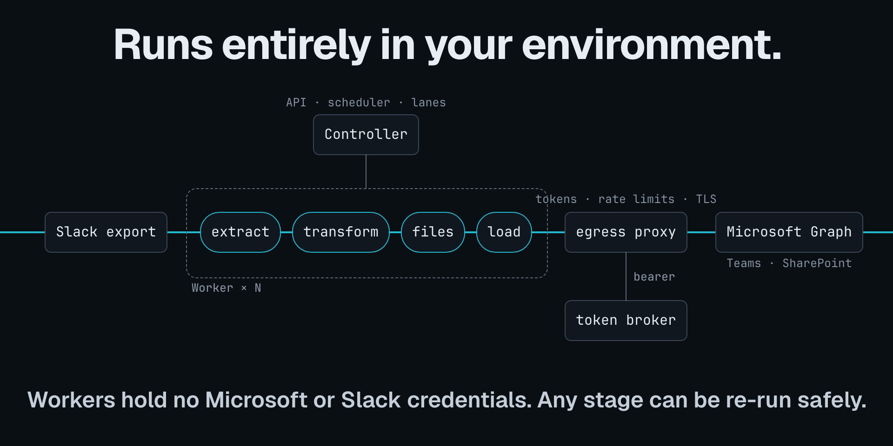
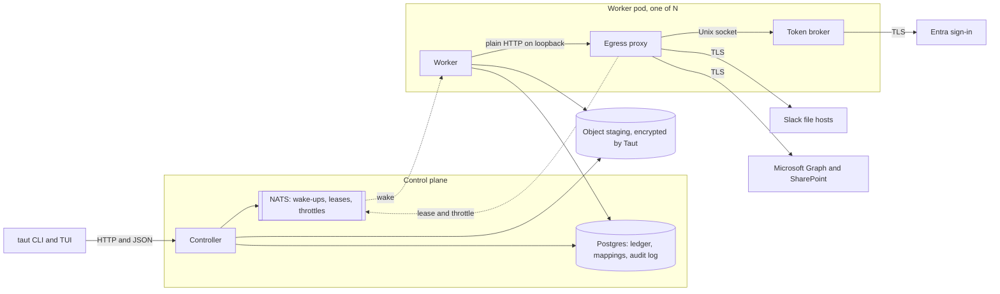
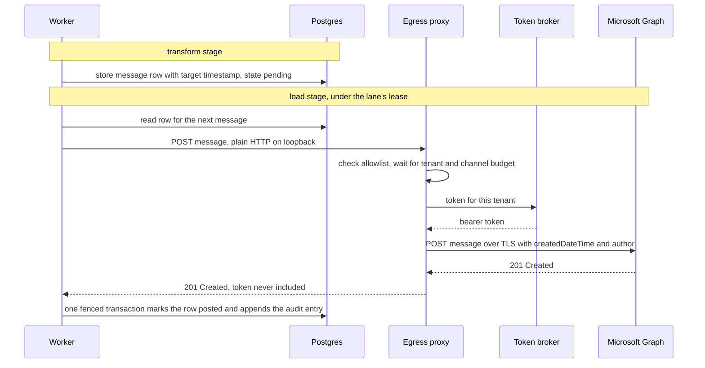
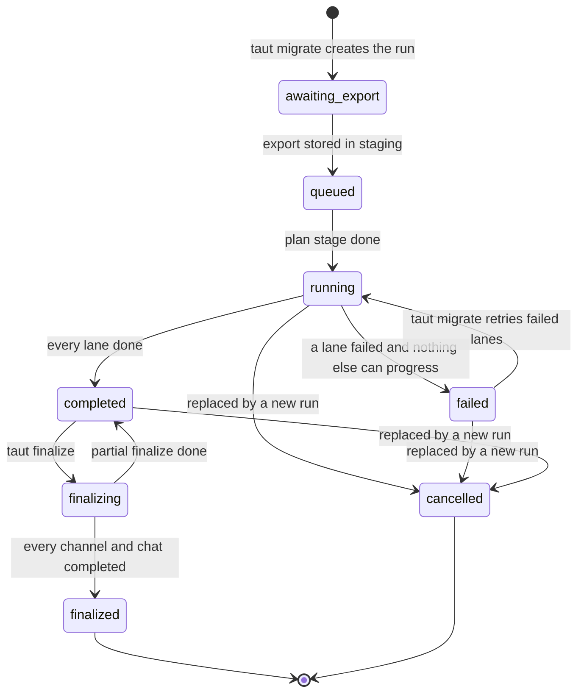
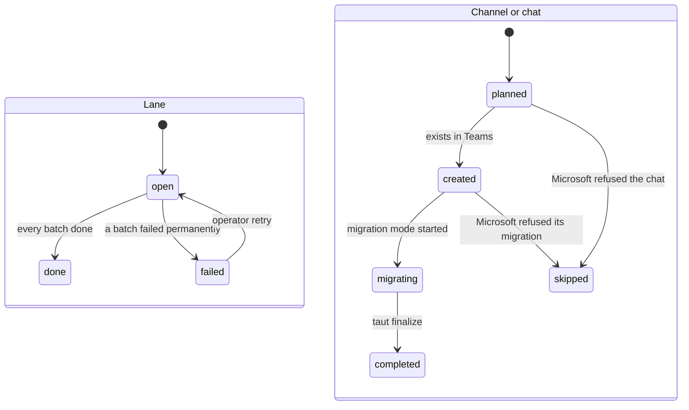
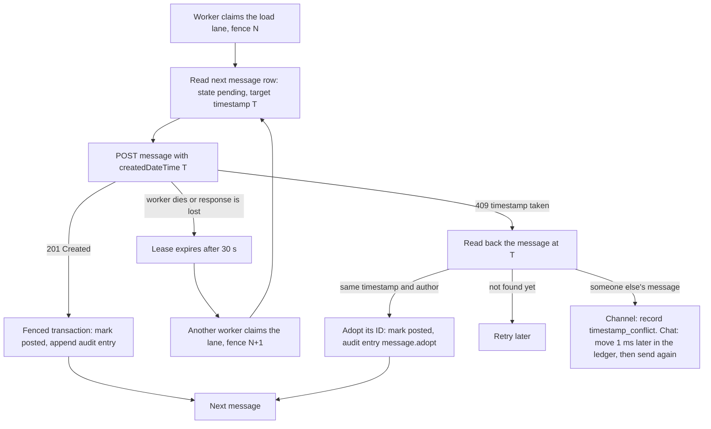
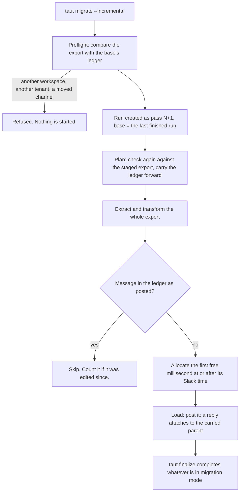
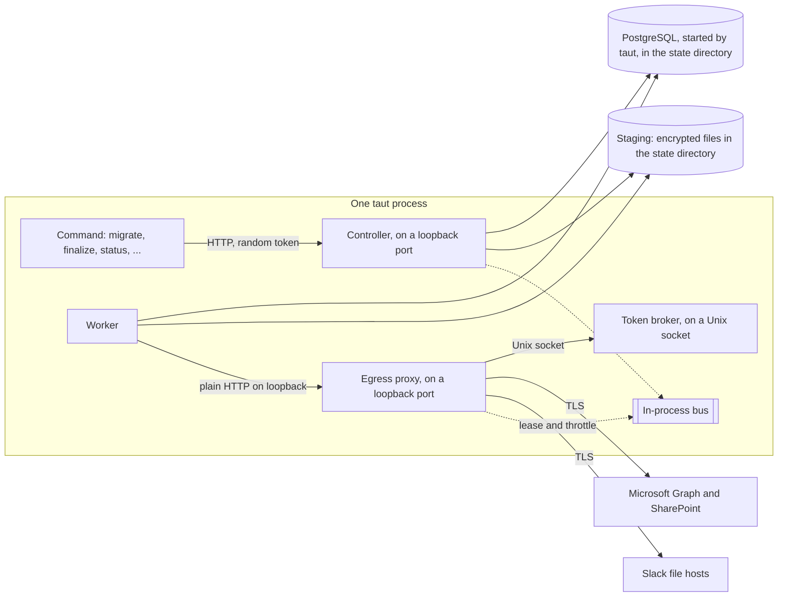

# How Taut works

After reading this page you will know which processes make up a Taut
deployment, what each one holds and can reach, how a Slack message becomes a
Teams message, and why a run can be killed at any point and resumed without
importing anything twice.

> [!WARNING]
> Taut has not been run against a real Microsoft tenant. Everything described
> here is verified against the fake Microsoft and Slack services that ship in
> this repository (`internal/fakegraph`, `internal/fakeslack`). The fakes
> encode one reading of the vendors' documentation. Where Taut depends on
> behavior the documentation leaves open, this page says so, and
> [Known limitations](migration-guide.md#known-limitations) lists the open
> items in one place.

<p align="center">
  
</p>

**Contents**

- [The parts](#the-parts)
- [The pipeline](#the-pipeline)
- [One message from Slack to Teams](#one-message-from-slack-to-teams)
- [Lanes, leases and fences](#lanes-leases-and-fences)
- [Run and lane states](#run-and-lane-states)
- [Resuming without duplicates](#resuming-without-duplicates)
- [Rate budgets and throttling](#rate-budgets-and-throttling)
- [Migration mode and finalize](#migration-mode-and-finalize)
- [Incremental passes](#incremental-passes)
- [Load strategies](#load-strategies)
- [Identity mapping](#identity-mapping)
- [What Teams cannot import](#what-teams-cannot-import)
- [Direct messages](#direct-messages)
- [The audit log](#the-audit-log)
- [Security model](#security-model)
- [Local mode](#local-mode)
- [Telemetry](#telemetry)
- [Repository layout](#repository-layout)

## The parts

One Go binary plays every role: `taut controller`, `taut worker`,
`taut sidecar token-broker`, `taut sidecar egress-proxy`, and the operator's
CLI. There is one image to build and scan, and the components cannot drift
apart in version.

| Part | What it does |
|---|---|
| CLI | Runs on the operator's machine. `init`, `auth`, `preflight`, `map` and `doctor` work in-process. `migrate`, `status`, `dashboard`, `finalize` and `audit` talk to the controller over HTTP. |
| Controller | The control plane: the API, the run's status, rate budget allocation, purging staging. It writes nothing to Slack or Teams. |
| Worker | Claims lanes from Postgres and does the work of each stage. It holds no Microsoft or Slack credential. |
| Egress proxy | A forward proxy on the worker's loopback interface. Every request to Microsoft or Slack goes through it. It attaches the token, enforces rate limits and originates TLS. |
| Token broker | The only process that reads the Entra credential and the Slack token. It serves bearer tokens to the egress proxy over a Unix socket. |
| Postgres | The job ledger, the Slack-to-Teams mapping tables and the audit log. The single source of truth. |
| NATS | Transport only: wake-up hints, budget leases, throttle broadcasts. Core NATS; JetStream is not used. |
| Object staging | Any S3-compatible bucket. Holds the export and each stage's batch files, encrypted by Taut before upload. |
| Telemetry collector | Your OpenTelemetry collector, if you set one. Taut pushes traces and metrics to it over OTLP/gRPC. |



Workers never call the controller. They find work in Postgres and are woken
over NATS, so the controller can restart during a run without stopping it.

For a small workspace the same parts can run inside one process on the
operator's machine, with nothing deployed: see [Local mode](#local-mode).

## The pipeline

A migration is a **run** of one config file. The work is split into stages.
Each stage reads and writes batch files in staging, and records its progress
in Postgres.

| Stage | Lanes | What it does |
|---|---|---|
| `plan` | one per run | Reads the export, resolves the config file into teams, channels and day batches, and writes the lanes for every other stage. For an incremental pass it also carries the earlier pass's ledger forward. |
| `extract` | one per channel | Reads the channel's day files from the export ZIP as a stream and writes normalized batches. |
| `transform` | one per channel | Converts each message to Teams HTML, resolves authors and mentions through the identity map, and allocates each message's target timestamp. No network calls. |
| `team` | one per team | Creates the team, or adopts one found by name. |
| `files` | one per channel | Streams each file from Slack into encrypted staging, then into the channel's SharePoint folder under `Slack/`. |
| `load` | one per channel | Creates the channel, starts migration mode, and posts messages and replies in order with their original authors and times. |
| `finalize` | one per channel or chat | Completes migration mode. Added to the run by `taut finalize`. |
| `members` | one per team | Adds team members, then each private channel's members. Added by `taut finalize`. |
| `release` | one per chat | Takes a chat out of migration mode when its run is cancelled, failed or replaced. |

Per channel, the order is: create the channel, upload its files, start
migration mode, import messages. A channel's messages wait for its files so
that each message can attach the files it refers to.

The export ZIP reaches staging through the controller. `taut migrate`
streams it to the controller, which encrypts it into the bucket. The
operator's machine needs the controller's URL and API token and nothing
else: no bucket credentials, no staging key. Each worker downloads and
decrypts its own scratch copy for as long as it works on the run.

## One message from Slack to Teams



The worker's request carries two extra headers that name the real origin
and how to authenticate. The egress proxy drops any inbound `Authorization`
header, so a worker cannot supply a token of its own.

## Lanes, leases and fences

A **lane** is the ordered queue of batches for one subject in one stage:
`extract:C024BE91L`, `load:C024BE91L`, `team:0`, `members:0`. Most lanes are
keyed by a Slack channel ID.

- A worker claims a lane by taking a **lease** on its row in Postgres
  (`SELECT ... FOR UPDATE SKIP LOCKED`). The lease lasts 30 seconds and the
  worker renews it every 10.
- Every claim increments the lane's **fence**, a counter. Every ledger write
  is conditional on the fence the writer holds. A worker that lost its lease
  (paused, partitioned, killed and replaced) cannot record anything.
- A load lane has one holder at a time, which gives strict chronological
  order within a channel. A reply's Slack timestamp is always later than its
  parent's, so parents are posted before replies. If a parent failed
  permanently, its replies are held and reported instead of being posted as
  orphans.
- A worker that cannot renew for a whole lease lifetime stops working the
  lane. A worker told to stop hands its lanes back before it exits.
- A batch that keeps failing is retried with backoff, up to 8 attempts. Then
  the lane is marked failed and waits for an operator. An attempt that made
  progress before failing is not counted.

One holder per channel costs no throughput. Microsoft limits a channel to a
few messages a second, far below what one worker can send. Parallelism comes
from importing many channels at once. One worker runs four lanes at a time
by default (`TAUT_WORKER_CONCURRENCY`).

NATS carries one kind of message for this: "there may be work". Workers
treat it as a hint and ask Postgres what is claimable. They also poll every
two seconds, so a lost signal delays work and cannot corrupt it.

## Run and lane states

The names below are the values stored in Postgres and shown by
`taut status --json`.





| Record | States |
|---|---|
| Batch | `pending`, `done`, `failed` |
| Message | `pending` (timestamp allocated, not posted), `posted`, `failed` (Graph rejected it permanently), `held` (its thread parent failed) |
| File | `pending`, `staged`, `uploaded`, `skipped` (not copied by design), `failed` |

`skipped` applies to direct-message conversations only. A run is replaced
by `taut migrate --new`, which cancels it. A completed or finalized run can
instead be followed by an [incremental pass](#incremental-passes), which is
a new run that starts from its ledger; the run that is followed keeps its
status.

## Resuming without duplicates

Microsoft Graph has no idempotency key for imports, and an app cannot delete
a message it imported. Taut relies on one thing Graph does enforce: it
refuses a second message with the same millisecond `createdDateTime` in a
channel, with `409`.

Three things together give duplicate-free resume:

1. **Intent before effect.** The transform stage gives every message a
   unique millisecond timestamp in its channel: the Slack `ts` truncated to
   milliseconds, moved 1 ms later per collision, in `ts` order. That
   timestamp is stored in `map_messages` before anything is sent.
2. **Graph's uniqueness check.** If a worker dies after Graph accepted a
   message and before recording it, the retry is refused with `409`. Taut
   reads the existing message back and adopts its ID if it has the allocated
   timestamp and the attributed author.
3. **Fenced leases.** A stale worker cannot advance the ledger, and each
   batch attempt stages its output under a key that includes its fence.



Some consequences worth knowing:

- Some messages land a few milliseconds later than in Slack.
- Slack `ts` values are stored as the original strings and never parsed to
  floats.
- Adoption compares timestamp and author, not the body, because Graph may
  normalize HTML. Within one run that is exact. A second run started with
  `taut migrate --new` into channels an earlier run populated adopts the
  earlier run's messages only as far as it allocates the same timestamps,
  which holds for the same export and config file. To add a newer export
  to what is there, use an [incremental pass](#incremental-passes), which
  starts from the earlier run's ledger instead of rediscovering it.
- Reactions travel in the message itself, so a message is adopted with
  them. The read-back returns them, and if an adopted message holds a
  different number than was sent, its audit entry says how many.
- File uploads are idempotent by content hash and target path. Teams and
  channels are found again through the mapping tables, or by display name
  when the response to their creation was lost.
- Read-back by ID assumes a Teams message ID equals its epoch-millisecond
  timestamp, which Microsoft's examples show and do not promise. The
  fallback lists messages around that timestamp.
- Restoring an older Postgres backup mid-run is safe for messages for the
  same reason: each already-posted message is refused and adopted.

The test suite checks this by killing workers and egress proxies during an
import while the fake Graph drops responses after committing, throttles and
returns errors, then asserting that the fake tenant holds every message
once, in order. `make kill-test` does the same with real containers.

## Rate budgets and throttling

Microsoft's pages give two figures for the per-channel import rate, 1 and 5
requests a second. Limits are therefore configuration with conservative
defaults, and the egress proxy adapts.

| Scope | Default | Enforced by |
|---|---|---|
| Graph, per tenant | 40 requests/s | The controller leases a share to each egress proxy over NATS |
| SharePoint, per tenant | 20 requests/s | Leased, as above |
| Slack, per workspace | 1 request/s | Leased, as above |
| Channel message posts | Starts at 1/s, rises by 0.5/s per 30 successful posts, up to 5/s | The lane holder's egress proxy, locally |
| Chat message posts | 1/s, lowered on throttling and never raised | The lane holder's egress proxy, locally |
| All chats together | 0.4 of the proxy's Graph lease: 16 requests/s of the default 40 | Each egress proxy |

- A channel has one lane holder, so its budget needs no coordination.
- Leases last a few seconds and are refreshed in the background. If the
  controller or NATS is unreachable, the proxy falls back to a small safe
  rate. It is never unlimited.
- The proxy delays requests. It does not reject them for rate.
- On `429`, or `503` with `Retry-After`, the proxy pauses for `Retry-After`
  plus up to 10% jitter and halves the rate. For a message post the channel
  takes the full pause and the tenant scope takes a short hedge (at most
  2 s, rate cut by 10%), because Graph does not say which limit was hit.
- A tenant-scope pause is published on NATS. Every egress proxy serving
  that tenant applies it, so they back off together. A pause received from
  another proxy lasts at most 30 seconds.
- Rates recover on success: the tenant multiplier by 0.02 per second of
  clean traffic, a channel by 0.5/s per 30 posts.
- The proxy passes the `429` back unchanged. The worker's HTTP client
  honors `Retry-After` and retries, and the retry waits behind the pause.

The measured effect is in [LOADTEST.md](LOADTEST.md). Against the fake
enforcing the documented limits, Taut reached 40 messages a second and held
it with no 429. Team membership writes are limited by Microsoft to four
requests a minute per team; Taut adds team members 200 per request and
otherwise paces membership writes only by honoring 429s.

## Migration mode and finalize

Teams accepts messages with original authors and timestamps only while a
channel is in **migration mode**. A channel in migration mode is locked.
Completing migration mode opens it. After that, more can be imported with
original dates only by putting the channel back into migration mode, which
is what an [incremental pass](#incremental-passes) does when it has to.

`taut migrate` leaves every channel in migration mode. `taut finalize` is a
separate, deliberate step. It is ledger work like the import: the controller
adds `finalize` and `members` lanes to the run, and workers do them under
the same leases, fences and retries. Killing the CLI or the controller
during a finalize changes nothing.

What finalize does, in order:

1. Completes migration mode on each selected channel and chat. A repeated
   `completeMigration` is refused by Graph as "not in migration mode", which
   the stage reads as done.
2. Once every channel of a team is open, adds the team's members. The stage
   lists who is already there and adds only who is missing, so existing
   owners of an adopted team are not demoted and a retry continues where it
   stopped.
3. Adds each private channel's own Slack members to that channel.
4. Deletes the run's staging objects, then destroys its data key, unless
   `--retain` was given.

Who becomes a member: the people in the team's migrated channels in the
export who are full, current, human Slack members with a Microsoft 365
account. Guests, bots, deactivated users and Slack Connect users are never
added. Being mapped as an author does not make someone a member.

> [!CAUTION]
> Completing migration mode opens the channels to their members, and what
> was imported cannot be removed by Taut. Check the import in Teams as the
> team's owner before running `taut finalize`.

Command behavior, flags and partial finalizes are in
[cli.md](cli.md#taut-finalize).

## Incremental passes

People keep using Slack while a long migration runs. An **incremental
pass** imports, from a newer export of the same workspace, what the passes
before it did not: new messages, new thread replies (including replies to
threads an earlier pass imported) and new files, into the same teams,
channels and chats. `taut migrate --incremental` starts one.

A pass is a run. Pass 1 is the first import. Every later pass names the run
it follows, its **base**, and its plan stage copies what the base recorded
as being in Teams into the new run's ledger as **carried** rows, in the
same transaction as the plan:

| Carried | What it gives the pass |
|---|---|
| Teams and channels, with their Teams IDs and states | The pass imports into what exists. Nothing is created or adopted by name. |
| Posted messages, with their Teams IDs and allocated milliseconds | A carried message is never sent again. A new reply finds the Teams ID of the message it replies to. No new message is given a millisecond that is taken. |
| Thread anchors | A reply to a thread whose first message was never migrated attaches where the earlier replies did. |
| Uploaded files | A file that is already in SharePoint is attached from there, not uploaded again. |

Only facts are carried. A message the base failed to import, or held
because its thread parent failed, is not in Teams; the pass treats it as
new and tries again.



How the pieces behave:

- **The whole export is read again.** Extract and transform run over every
  day, and transform drops what is carried. That costs CPU and no Graph
  calls, and it means the newer export may be a full export or one of a
  narrower date range: either way a message is new exactly when the ledger
  does not have it as posted.
- **Timestamps stay the idempotency key.** A first pass allocates in Slack
  order and never looks back. An incremental pass also asks the ledger
  which milliseconds are taken around each new message, so a message that
  turns up inside already-migrated history lands one millisecond after its
  neighbor instead of colliding with it. A new reply is always placed after
  the message it replies to.
- **Killing a pass is as safe as killing a first import.** The same leases,
  fences, 409 handling and read-back apply. The kill-and-resume test runs
  an incremental pass over the medium fixture pair while workers are
  killed and replaced several times a second and the fake Graph loses
  responses after committing.
- **One pass at a time, in a line.** A base has at most one pass after it,
  and it must have finished importing. A pass in progress is resumed, not
  replaced: once it has planned, it holds the record of what the migration
  has sent. A pass that failed before it planned has written nothing and
  can be started again with `taut migrate --incremental --new`.
- **The base is over once the pass has planned.** The pass has its ledger,
  so the base's staged export is deleted like a finalized run's, and
  `taut finalize` works on the latest pass only. Each pass keeps its own
  audit log.

### The same workspace, the same places

A pass must not put one workspace's history into another's channels. Two
signals decide whether an export is of the workspace the earlier passes
migrated, because an export has no field that names its workspace:

1. Slack conversation IDs are unique. One conversation in common with the
   ledger settles it.
2. Otherwise the workspace ID that most users in `users.json` carry must be
   the one recorded for the earlier pass. An export with no conversation in
   common and no matching ID is refused.

The same comparison refuses a config file that names another tenant, moves
a migrated channel to another team, or stops selecting a migrated channel
that the export still has. `taut preflight --incremental` reports all of
this, and the plan stage checks it again against the export that was
actually uploaded, before anything is written.

A channel that was deleted in Slack between two exports is not in the newer
one. It stays in the pass's ledger with no work, so that `taut finalize`
still completes it.

### Before and after finalize

| The base is | What the pass does |
|---|---|
| Completed, not finalized | Channels are still in migration mode. The pass imports into them. |
| Finalized | A channel with something new is put back into migration mode with `startMigration`, and completed again by the next `taut finalize`. A channel with nothing new is not touched. |

Microsoft documents the second case: after `completeMigration`, "you can
continue importing messages by using the `startMigration` API". The
re-entry is lazy. A finalized channel is reopened by the first day of
messages that has something to import, so a pass with nothing new makes no
write requests at all.

`startMigration` takes a creation time that "must be older than the current
`createdDateTime`". What happens when it is left out is described two ways
in Microsoft's pages, so Taut always sends one: the time the history needs,
or one second before the channel's current creation time when that is
already old enough. The fake Graph can be made to enforce either reading
and the tests run under both.

While a channel is back in migration mode, Teams shows a banner that a
migration is in progress, and Microsoft's reference says migration mode
prevents sending messages and adding members. `taut preflight
--incremental` warns with the list of channels it would reopen.

`startMigration` exists in the global cloud only, and the `legacy` strategy
does not use it. Under `legacy`, incremental passes work until the first
`taut finalize` and are refused after it, in preflight, with the reason.

### What a pass cannot do

Graph's import API adds messages. It cannot change or delete one.

| In Slack since the earlier pass | In Teams |
|---|---|
| A message was edited | The text that was imported stays. Counted in preflight and by the transform stage (`edited_since`). |
| A message was deleted | It stays. Counted in preflight. Delete it in Teams as the channel's owner if it must go. |
| Reactions were added to a migrated message | Not updated. |
| A person joined | They can be an author at once, and become a team member at the next `taut finalize`. |
| A person left a channel | Not removed from the team. |
| A message Teams users wrote after finalize holds the millisecond a new Slack message needs | In a chat the Slack message moves one millisecond later. In a channel it is recorded as `timestamp_conflict` and not imported. |

> [!IMPORTANT]
> Incremental passes are built and tested against the fake only. Putting a
> finalized channel or chat back into migration mode is documented by
> Microsoft and has not been run by Taut against a real tenant.

## Load strategies

`load.strategy` in the config file chooses how history gets into Teams.

| | `modern` (default) | `legacy` |
|---|---|---|
| Where | Global cloud | Every cloud. The only choice in the national clouds. |
| How | Teams and channels are created normally, then put into migration mode with `startMigration` | Teams and channels are created already in migration mode |
| During the import | The team's owner can see it | Nobody can: the team has no members, not even its owner |
| Private channels | Yes | No |
| An existing team | Can be imported into | Cannot. Choose a new name. |
| A channel that leaves migration mode early | Is reopened | Cannot be reopened. Its lane stops and says so. |
| Files | Uploaded before migration mode starts | Uploaded during migration mode. If the channel's folder does not appear within ten minutes, messages carry a note instead of the file. |
| `taut finalize` | Completes each channel, then adds members | Completes each channel and General, then the team, then adds the owner and members |
| Direct messages | Yes, if turned on | No |

Both `startMigration` calls exist in the global cloud only, which is why
`legacy` exists. `legacy` is the older flow: Microsoft's import guide now
documents `startMigration` only, and creation in migration mode survives in
the API reference examples. Treat `legacy` as carrying more risk.

Under `legacy` there is no owner to check the import with before finalize.
Verify with `taut audit` and `taut dashboard`, or with tenant-admin tools.
`taut preflight` shows which strategy is in use and what follows from it.

> [!IMPORTANT]
> Neither strategy has been run against a real tenant. Private channels and
> the `legacy` strategy are built and tested against the fake only.

## Identity mapping

Authors and mentions are resolved in this order:

1. The override CSV (`identity.overrides`), with the columns
   `slack_user_id,slack_email,entra`. The `entra` value is a UPN or an
   object ID, or `none` for someone who has no account and must not be
   matched to one.
2. The Slack user's email against the Entra directory: `mail`,
   `userPrincipalName` and proxy addresses, case-insensitively.
3. If `identity.match.emailLocalPart` is on: the part of the Slack email
   before the `@` against the same part of those addresses.
4. If `identity.match.displayName` is on: the Slack real name or display
   name against the Entra display name.

Steps 3 and 4 guess, and are off by default. Each matches a Slack user only
to a member account that nothing stronger has matched, only when exactly one
account fits, and only when no other Slack user would get the same account.
Bots, apps, guests and Slack Connect users are left out. `taut preflight`
lists each such match with the account it chose, and a person matched this
way is not put into the chat of a direct message until the override CSV
confirms the match. The rules are in
[configuration.md](configuration.md#identity).

Anyone left over is unmapped: deactivated users whose account is gone,
external and guest users, bots and apps. Graph requires the author of an
imported message to be a user of the tenant, so `identity.unmapped.policy`
decides what happens to their messages:

| Policy | Effect |
|---|---|
| `former-member` (default) | Messages are attributed to the placeholder account in `identity.unmapped.account`, with the original display name shown in the message |
| `service-account` | The same mechanism, using a service account you name |
| `block` | `taut preflight` reports a blocker and `taut migrate` refuses to start while any unmapped author remains |

`taut preflight` lists every unmapped user with their message count and the
reason, and with `--json` every matched person with the method that matched
them.

## What Teams cannot import

Graph's import API does not carry everything Slack stores. `taut preflight`
counts each of these in your export before anything is written.

| Slack | In Teams |
|---|---|
| Messages, threads, rich text, code, quotes | Imported with original time and author |
| Block Kit `markdown` blocks | Formatted text: headings in bold, lists, links, code, quotes, tables |
| Block Kit `table` blocks | HTML tables, with the columns' alignment |
| Other Block Kit blocks[^blocks] | Their text. A video keeps its title and link, an image its alt text. |
| User mentions | Teams mention entities |
| `@here`, `@channel`, `@everyone` | Plain text, so the import notifies nobody |
| Emoji shortcodes | Unicode, including skin tones. Custom emoji stay as `:name:` text. |
| Reactions | A summary line under the message by default, or Teams reactions with `content.reactions: native`[^reactions] |
| Edited messages | Final text with an "(edited)" marker. No edit history. |
| Deleted and hidden messages, join, leave and topic notices | Not migrated |
| Bot and app messages | Attributed to the placeholder account, with the bot's name shown |
| People with no Entra account | Per the [unmapped policy](#identity-mapping) |
| Files | Copied to the channel's Files tab under `Slack/` and attached. Images up to 1 MiB are shown inline, up to 3 MiB per message. |
| Files hosted outside Slack | The link is kept. The file is not copied. |
| Canvases | Uploaded as HTML files |
| Huddles | A one-line placeholder |
| Deleted thread starters | A placeholder, so replies keep their thread |
| Pinned-item notices | Not migrated |
| Messages over 80 KB | Split into consecutive posts |
| Channel names Teams forbids | Renamed. `taut map` shows the new name. |
| Shared channels | Not migrated |
| Direct messages and group DMs | Into Teams chats if turned on, without files or threads |

Every field of the export is treated as optional. Unknown message subtypes
are imported as plain text instead of failing the batch.

[^blocks]: A message's blocks are used when they carry its content
    (`rich_text`, `markdown`, `table`, `plan` and `task_card` blocks, alone
    or in a `container`) or when the message has no text. Otherwise the text
    is used, because apps send blocks that decorate a complete text
    fallback. `section`, `header`, `context`, `image`, `video`, `file`,
    `card`, `container`, `plan` and `task_card` blocks are rendered as text.
    Interactive blocks and block types Taut does not know (`actions`,
    `input`, `carousel`, `layout`, `data_table`, `data_visualization`) are
    skipped and counted as warnings in the transform stage's statistics.

[^reactions]: With `native`, each reaction whose emoji is a Unicode emoji
    and whose author has a Microsoft 365 account is sent in the imported
    message's `reactions` collection, attributed to that account and dated
    like the message, since an export does not say when a reaction was
    given. A message carries at most 250, the number Microsoft's import
    guide puts in scope. Custom emoji, people with no account, a second
    reaction that would be the same person and emoji in Teams, and anything
    past 250 are counted in a line under the message, so the totals still
    add up. If Graph refuses the reactions of a message, the message is
    sent again with the summary line `footer` would have written, and the
    audit entry says so; after three refusals in a row a worker stops asking
    for that channel. This is verified against the fake only: Microsoft
    documents the scope and the `chatMessageReaction` resource, and shows
    no import request that carries a reaction. `footer` stays the default.


## Direct messages

Direct messages and group DMs are off by default. With
`target.directMessages.enabled: true` they take the same pipeline into Teams
chats instead of channels. A conversation is a channel mapping with no team.
Its load lane creates or finds the chat and starts its migration mode. It
has no files lane, and its finalize lane completes the chat.

- A one-on-one DM goes into the one-on-one chat of the same two people,
  which is the chat they already have if they have one. A group DM goes
  into a new group chat.
- A conversation migrates with all of its participants as themselves, or
  not at all. The placeholder account is never put into a chat.
- Chats have no threads. Replies become ordinary messages at the time they
  were written.
- Files are not moved. Each message that had one says so.
- If a message already in the chat holds the millisecond a Slack message
  needs, the Slack message is moved one millisecond later, in the ledger
  first, and then sent. The messages that follow it without a gap move with
  it, at most 100 ms in total.
- A chat is visible to its participants while it is in migration mode. A
  run that fails or is cancelled must not leave chats that way, which is
  what the `release` stage is for.

What an operator needs to know before turning this on is in the
[migration guide](migration-guide.md#direct-messages).

> [!IMPORTANT]
> Direct-message migration is built and tested against the fake only. Chat
> import is the least documented part of Graph's import API.

## The audit log

Every write to Teams or SharePoint, and every attempt that failed for good,
appends one entry: the stream (the lane), a sequence number, the time, the
worker, the operation, the Slack source ID, the Teams target ID, a SHA-256
of the content sent, and the outcome.

- Entries are hash-chained per lane. Each stores the previous entry's hash,
  and a separate head record per chain lets verification detect a truncated
  tail as well as edits and gaps.
- An entry is appended inside the lane's fenced transaction, so each write
  is recorded once however many attempts it took.
- The database rejects `UPDATE`, `DELETE` and `TRUNCATE` on the table.
- `taut migrate` verifies the chains before it reports success, and
  `taut finalize` verifies them before it asks for confirmation.
- Entries for chat messages carry no content hash. For a short message
  between two people, a hash is a guessable fingerprint.

Operations include `team.create`, `channel.create`,
`channel.start_migration`, `message.import`, `message.adopt`,
`message.fail`, `file.upload`, `file.fail`, `channel.complete_migration`,
`member.add` and `member.skip`. `taut audit` searches, verifies and exports
the log; see [cli.md](cli.md#taut-audit).

## Security model

Taut is self-hosted. The export, the tenant and the credentials stay in your
environment and pass through no one else's service.

### Who holds what

| Process | Holds | Can reach |
|---|---|---|
| Worker | No Microsoft or Slack credential. It does hold the Postgres URL, the staging key and the bucket keys. | Its egress proxy, Postgres, NATS, staging |
| Egress proxy | Tokens in passing, never stored | Microsoft Graph, SharePoint and Slack hosts on its allowlist |
| Token broker | The Entra credential and the Slack token | Entra's sign-in endpoint, for the tenants it is pinned to |
| Controller | The staging key, the Postgres URL, the bucket keys, its API token | Postgres, NATS, staging. Never Microsoft or Slack. |
| CLI | The controller's API token. For `auth` and `preflight`, the credentials the config file references. | The controller. For `auth` and `preflight`, Microsoft and Slack directly. |

### What each part refuses

- A worker refuses to start without an egress proxy.
- The token broker signs in only to tenants listed in its own configuration
  (`TAUT_TOKEN_TENANTS`), and optionally only as listed applications and in
  listed clouds. With none listed it refuses everything. It reads file
  references only under `/run/secrets/taut` by default.
- The egress proxy forwards only to `https` origins on its allowlist. It
  never follows redirects. An Entra token goes only to the Graph origin of
  its own cloud, never to SharePoint, whose upload sessions are
  pre-authorized. A Slack token goes only to Slack's API paths or file
  hosts.
- The controller refuses to start without an API token, and rejects config
  files that override Microsoft or Slack endpoints.
- File URLs in the export are untrusted. Only `https` URLs on Slack's file
  hosts are fetched, and redirects are followed by hand and only to such
  URLs.

Each refusal has an explicitly named override for a throwaway local stack:
`TAUT_INSECURE_NO_SIDECARS=1`, `TAUT_CONTROLLER_INSECURE=1`,
`TAUT_ALLOW_TEST_ENDPOINTS=1`. The Helm chart refuses the first.

### Secrets and redaction

- The config file holds references (`{ env: NAME }` or `{ file: path }`),
  never values. Taut refuses to load a config file containing something
  shaped like a token, key or client secret.
- Tokens are redacted from all output and logs. The egress proxy scrubs
  `Authorization` headers and the `?t=` tokens in Slack file URLs from
  anything it logs.
- Text that comes from the export or from Graph (channel names, lane
  errors) is sanitized before it reaches the terminal.

### Staging encryption

The object store is treated as untrusted. Every object is encrypted and
authenticated in the client with AES-256-GCM in 64 KiB chunks, under a
per-run data key. The data key is wrapped by a key-encryption key you supply
(`TAUT_STAGING_KEY`, from the environment or a file) and stored with the
run. Purging a run deletes its objects and then destroys the wrapped key.
Object key names are not encrypted and contain only identifiers.

### Limits of this arrangement

- A compromised worker can do, through its egress proxy, whatever the Entra
  application and the Slack token permit. Isolating credentials limits what
  leaks. It does not limit what the application can be made to do.
- The egress proxy does not authenticate its caller. Loopback binding
  inside the pod is the barrier.
- Messages on NATS are not authenticated by Taut. What a forged message can
  do is clamped, and the real control is NATS subject permissions, which
  you configure: see [OPERATIONS.md](OPERATIONS.md#9-nats-authorization).
- One controller token grants everything.
- The token broker does not check the peer on its socket. It relies on the
  socket's directory being private and not mounted into the worker.
- `Teamwork.Migrate.All` lets the app post as any user with any timestamp.
  Remove the app registration when the migration is finished.

## Local mode

With `local.enabled: true` in the config file, one `taut` process is the
whole deployment. Each command that needs the control plane starts it
inside itself and stops it when the command ends.



| Part | On a cluster | In local mode |
|---|---|---|
| Ledger | Postgres you run | The same schema and the same code, in a PostgreSQL server `taut` starts in the state directory and stops when the command ends |
| Transport | NATS | The in-process bus, which implements the same interface |
| Staging | An S3-compatible bucket | Files in the state directory, under the same envelope encryption |
| Staging key | Supplied by you | Generated on first use and kept in the state directory |
| Controller | A deployment | In the process, on a loopback port, behind a random token |
| Worker | N pods | One, in the process, four lanes at a time |
| Token broker, egress proxy | Sidecar containers | In the process, on a Unix socket and a loopback port |

What does not change: lanes, leases and fences; timestamps as the
idempotency key; the audit log and its hash chains; the rate budgets, which
the egress proxy still leases from the allocator and enforces; finalize as
ledger work; incremental passes. A local migration that is killed, by
<kbd>Ctrl</kbd>+<kbd>C</kbd> or by `kill -9`, resumes from the state
directory the next time `taut migrate` runs. The test suite kills the real
binary twice mid-import and checks the fake tenant holds every message
once.

How the state directory is kept consistent:

- **One owner.** The process holds an operating-system lock on the state
  directory for as long as it runs. The lock goes when the process does,
  however it ends. A second command that would do work is refused. A
  command that only reads (`status`, `dashboard`, `audit`) connects to the
  owner's controller instead, using the address and token the owner wrote
  into the directory.
- **PostgreSQL is a child process.** It listens on a free loopback port with
  a password generated for this state directory, and has no socket file. If
  `taut` is killed outright it is left running; the next command stops it
  before starting its own. A ledger created by one major version of
  PostgreSQL is never opened or re-created by another: the command stops
  and says which version it needs.
- **Nothing is downloaded unless the config file says so.** An installed
  PostgreSQL is used when there is one. `local.postgres.download: true`
  allows one download into the user cache directory, announced when it
  happens: the PostgreSQL build of the `zonkyio/embedded-postgres-binaries`
  project, from Maven Central over TLS. It is compared with the SHA-256
  published beside it on the same host, which catches a damaged download
  and does not authenticate the build. Install PostgreSQL from your
  operating system's packages if you need more than that.

### What local mode gives up

The cluster's [security model](#security-model) rests on separate
processes: the worker cannot read the credential because another container
holds it. Local mode keeps the same boundaries in the code and loses the
separation between them.

| Property | Cluster | Local mode |
|---|---|---|
| The worker is given no Microsoft or Slack credential | Yes | Yes: it is built with the proxied route only |
| Every request to Microsoft passes the egress proxy's allowlist and budgets | Yes | Yes |
| The token broker signs in only for the configured tenant and application | Yes | Yes: it is pinned to the config file's tenant, client and the secrets it references |
| The credential is out of reach of a compromised worker | Yes: another container | **No.** One process, one address space, one user account |
| The staging key is held apart from the data | By your secret store | **No.** It is a file in the state directory, beside the data it protects |
| Survives the machine being switched off | Yes | The run pauses until `taut migrate` is run again |

So local mode protects against mistakes (a config file that names the wrong
host, a runaway request rate, a stale process writing to the ledger) the
same way a cluster does, and does not protect against an attacker who can
run code as you. Encryption of the state directory's staging is against
casual reading and for clean deletion at finalize, not against someone who
has the directory. Use local mode on a machine you trust.

> [!IMPORTANT]
> Local mode is tested against the fakes on Linux and macOS. It has not
> been run against a real tenant, and not on Windows.

## Telemetry

With `OTEL_EXPORTER_OTLP_ENDPOINT` set, the controller, the workers and the
egress proxies emit OpenTelemetry traces and metrics over OTLP/gRPC. With no
endpoint the providers are no-ops.

- Metrics have fixed label sets: stage, outcome, route class, status code.
  Run, lane, channel, user and message IDs appear on spans, never on
  metrics.
- Nothing carries message text, names, email addresses, header values,
  query strings or full URLs. Spans record scheme, host and a route class.
- The egress proxy strips trace headers before a request leaves for
  Microsoft or Slack.
- Export errors never block or fail work.

Logs are structured JSON on stdout.

## Repository layout

<details>
<summary>Packages under <code>internal/</code></summary>

```text
cmd/taut/               entry point
internal/
  cli/                  Cobra commands
  fail/                 structured what/why/next errors and exit codes
  ui/                   output layer: TUI, plain and JSON from one result
  tui/theme/            design tokens (tokens.go) and derived styles
  tui/shell/            frame, help bar, global key map
  tui/report/           tabbed report screen, also rendered plain
  tui/checklist/        live check runner used by auth and doctor
  tui/forms/            form theme built from the tokens
  tui/mapping/          the map screen
  tui/dashboard/        the dashboard screen
  tui/auditlog/         the audit screen
  config/               schema, validation, secret hygiene
  secret/               redacting value type, references, log scrubbing
  slack/                export data types
  slack/export/         streaming export reader
  slackapi/             Slack Web API client and scope catalog
  graph/                Entra auth and a hand-written Graph client
  identity/             user mapping and override CSV
  preflight/            the preflight engine
  controller/           control plane: API, views, finalize planning
  local/                local mode: the whole stack in one process
  pipeline/             batch records passed between stages
  transform/            intermediate representation, parsers, HTML renderer
  worker/               plan, extract, transform, files, load, finalize
  sidecar/tokenbroker/  token broker
  sidecar/egressproxy/  egress proxy
  sidecar/budget/       rate budgets leased to egress proxies
  sidecar/wire/         types shared by workers and sidecars
  store/                Postgres ledger, mapping tables, audit log, migrations
  staging/              S3 and filesystem backends, envelope encryption
  bus/                  NATS wake-ups
  telemetry/            OpenTelemetry setup
  fakegraph/            fake Entra and Graph server
  fakeslack/            fake Slack Web API
  fixtures/             deterministic fixture export generator
  devstack/             wires fixtures and fakes together
deploy/compose/         Docker Compose stack
deploy/helm/taut/       Helm chart
scripts/                Entra app script, demos, load test
```

</details>
