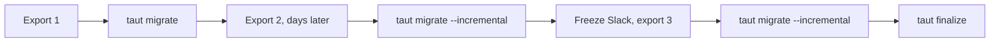

# Migration guide

After reading this page you will be able to prepare a tenant and a Slack
workspace for Taut, run a migration from export to finalize, and decide
whether to include private channels and direct messages.

> [!WARNING]
> Taut has not been run against a real Microsoft tenant. Every step below is
> verified against the fake Microsoft and Slack services in this repository.
> Rehearse against a non-production tenant first, and read
> [Known limitations](#known-limitations) before you start.

**Contents**

- [Before you start](#before-you-start)
- [Permissions](#permissions)
- [Steps](#steps)
- [Private channels](#private-channels)
- [Direct messages](#direct-messages)
- [Finalizing](#finalizing)
- [Migrating in passes](#migrating-in-passes)
- [Local mode](#local-mode)
- [Known limitations](#known-limitations)

## Before you start

You need:

- An Entra administrator who can create an app registration and grant admin
  consent.
- A Slack workspace owner or admin who can export the workspace and install
  an app.
- Somewhere for Taut to run. For a small workspace that is your own
  machine: see [Local mode](#local-mode), which needs nothing deployed. For
  a large one it is a Taut stack: the controller, workers with their
  sidecars, Postgres, NATS and an S3-compatible bucket. Locally that is
  `make up`. On Kubernetes, follow [OPERATIONS.md](OPERATIONS.md).
- A placeholder account in the tenant for authors who have no Microsoft 365
  account, unless you choose the `block` policy. See
  [Identity mapping](how-it-works.md#identity-mapping).

## Permissions

### Microsoft Graph

Application permissions, with admin consent.

| Permission | Needed for | When |
|---|---|---|
| `Teamwork.Migrate.All` | Migration mode; importing messages with original authors and times | Always |
| `User.Read.All` | Matching Slack users to Entra users | Always |
| `Team.Create` | Creating teams | Always |
| `Channel.Create` | Creating channels | Always |
| `TeamMember.ReadWrite.All` | Adding owners and members at `taut finalize` | Always |
| `ChannelMessage.Read.All` | Reading imported messages back, to resume without duplicates | Always |
| `Files.ReadWrite.All` | Creating channel folders and uploading small files in SharePoint | Always |
| `Sites.ReadWrite.All` | Uploading large files in resumable sessions | Always |
| `ChannelMember.ReadWrite.All` | Adding each private channel's members at `taut finalize` | Only with private channels |
| `Chat.Create` | Creating the chats direct messages are imported into | Only with direct messages |
| `Chat.ReadBasic.All` | Reading a chat's creation time; finding a group chat whose creation was interrupted | Only with direct messages |
| `Chat.Read.All` | Reading imported chat messages back, to resume without duplicates | Only with direct messages |
| `Organization.Read.All`, `Team.ReadBasic.All`, `Channel.ReadBasic.All` | Tenant name in `taut auth`; name-collision warnings in `taut preflight` | Recommended, never required |

`taut auth` reads the granted permissions from the access token's `roles`
claim and compares them with this list. A missing required permission exits
with code 4. A missing recommended permission is a warning, and the checks
that need it are skipped.

> [!CAUTION]
> `Teamwork.Migrate.All` lets the app post messages as any user with any
> timestamp. Treat its credential accordingly, and remove the app
> registration when the migration is finished.

### Slack

Bot token scopes. All are read-only except joining public channels.

| Scope | Why |
|---|---|
| `channels:read` | List public channels |
| `channels:history` | Read public channel messages and threads |
| `channels:join` | Join public channels so their history is readable |
| `users:read` | List members |
| `users:read.email` | Match members to Entra users by email |
| `files:read` | Download files shared in conversations |
| `emoji:read` | Resolve custom emoji |
| `team:read` | Identify the workspace |
| `groups:read`, `groups:history` | Private channels only |

Direct messages need no Slack scope. They are read from the export only.

The export ZIP is the source of messages, users and channels. Taut uses the
Slack token to check the app's scopes in `taut auth` and to download files
whose export links carry no token of their own.

## Steps

### 1. Create the Entra app registration

The script creates the app, uploads a certificate and grants consent. The
private key stays on your machine, in `taut-app.pem`. Look at what it will
do first.

```bash
./scripts/entra-app.sh --dry-run
```

```bash
./scripts/entra-app.sh
```

Add `--private-channels` or `--direct-messages` for the extra permissions
those features need.

> [!NOTE]
> The script has only been run with `--dry-run`. It has not created a real
> app registration.

### 2. Create the Slack app

Print the app manifest.

```bash
taut auth --slack-manifest
```

Create the app from it at <https://api.slack.com/apps> inside the workspace
you are migrating, install it, and copy the Bot User OAuth Token. The reason
each customer creates their own app is in the
[design notes](design-notes.md#a-slack-app-per-customer-from-a-manifest).

### 3. Export the workspace

In Slack: Admin → Workspace settings → Security → Import & export data →
Export tab. On Enterprise: Tools & settings → Organization settings →
Security → Exports.

- An export that includes direct messages needs a Business+ or Enterprise
  plan and an owner who has applied for it.
- A single-workspace export on Enterprise leaves out multi-workspace
  channels.
- File links in an export carry a token whose lifetime Slack does not
  document. Migrate soon after exporting.

### 4. Write the config file

```bash
taut init
```

The wizard asks for the export, the tenant, the app registration and the
team. It writes `taut.yaml`, which holds references to secrets and never
the secrets themselves. Every field is described in
[configuration.md](configuration.md).

### 5. Check credentials and permissions

```bash
export TAUT_SLACK_TOKEN=...   # the token itself never goes in the config file
```

```bash
taut auth
```

### 6. See what will and will not migrate

```bash
taut preflight
```

`preflight` is read-only. It reports counts, how each channel maps to Teams,
who cannot be mapped, which content Teams cannot import, and a time
estimate. It exits 3 if something must be fixed first.

People are matched by the override CSV and by email address. If many
accounts changed address between Slack and Entra, `identity.match` in the
config file can also match on the name part of the address and on the
display name. Those matches are guesses: `preflight` lists each one in its
People section, and they should be read before migrating. See
[configuration.md](configuration.md#identity).

To change which channels go where, or under what name:

```bash
taut map
```

### 7. Run the migration

```bash
export TAUT_CONTROLLER_TOKEN=...   # the controller's API token
```

```bash
taut migrate
```

`migrate` repeats the preflight, uploads the export through the controller
and shows progress. It is safe to stop at any time: <kbd>Ctrl</kbd>+<kbd>C</kbd>
detaches and the run continues. Run `taut migrate` again to reattach or to
resume a run that stopped. Watch from anywhere with:

```bash
taut dashboard
```

### 8. Check the result, then finalize

Open Teams as the team's owner and look at the imported channels. Then:

```bash
taut finalize
```

See [Finalizing](#finalizing).

### 9. Keep the audit trail

```bash
taut audit --verify --export audit.ndjson
```

## Private channels

Select them per team with `channels.types: [public, private]`, or
`taut init --include-private`. The export must include them, and the Slack
app needs `groups:read` and `groups:history`.

- A private Slack channel becomes a private Teams channel, created with the
  team's owner as its owner. Its files go to the SharePoint site Teams
  gives each private channel.
- Until `taut finalize`, only that owner can see it.
- At finalize the channel gets its own eligible Slack members and nobody
  else.
- Teams only lets members of a team into its private channels. The members
  of a private channel are therefore added to the team as well, and will
  see the team's standard channels. Give private channels a team of their
  own if that matters. `taut preflight` points it out.
- Private channels need the `modern` load strategy and the
  `ChannelMember.ReadWrite.All` permission.
- Shared channels are not migrated.

## Direct messages

Off by default. Turn them on with `target.directMessages.enabled: true` in
the config file, or `taut init --include-direct-messages`. They need the
global cloud and the `modern` load strategy; the config file is refused
otherwise. The export must include direct messages (`dms.json`,
`mpims.json`). The app needs `Chat.Create`, `Chat.ReadBasic.All` and
`Chat.Read.All` (`./scripts/entra-app.sh --direct-messages`).

A one-on-one DM is imported into the one-on-one Teams chat of the same two
people, which is the chat they already have if they have one. A group DM is
imported into a new group chat.

> [!CAUTION]
> These are private conversations, and they become visible at once. A chat
> is visible to its participants while the import runs, with a notice that
> a migration is in progress. Tell people first. `taut preflight` warns, and
> `taut migrate` asks about direct messages separately. With `--yes` it
> prints the warning instead.

What to know before turning this on:

- **All participants, as themselves, or not at all.** A conversation is
  left out if any participant has left Slack, is a guest, a bot or a Slack
  Connect user, or has no enabled Microsoft 365 account of their own. So
  are conversations with oneself or with Slackbot, conversations with a
  participant whose Microsoft 365 account is a guest of the tenant, could
  not be matched unambiguously, or was matched by name
  ([`identity.match`](configuration.md#identity)) and not confirmed in the
  override CSV, and any two conversations that would end up in one chat. The placeholder account is never put into a chat.
  `taut preflight` counts what is left out by reason.
- **Microsoft can still refuse a chat.** If creating a chat or starting its
  migration is refused for that conversation, the conversation is skipped
  and the run goes on. `taut status` and `taut audit --op chat.skip` say
  which and why.
- **Everyone in a group conversation sees all of it.** The export does not
  say when a person joined a group DM, so someone who joined late is given
  the whole history.
- **Files are not moved.** Each message that had a file says so.
- **Threads are flattened.** Replies become ordinary messages at the time
  they were written.
- **A message already in the chat is never touched.** If someone's own
  Teams message sits on the millisecond of a Slack message, the Slack
  message goes in one millisecond later.
- **Messages older than the chat.** If Teams will not make an existing chat
  any older, the messages older than the chat are reported as not imported
  and the rest of the conversation is imported.
- **Running it again uses the same chats.** `taut migrate --new` imports
  into the chats the earlier run used, group chats included, and does not
  import a message twice.
- **With direct messages off, they stay on your machine.** `taut migrate`
  uploads a copy of the export without them.

Privacy of what Taut shows and keeps:

- `taut preflight` gives counts and reasons in its plain output. With
  `--json` it lists each conversation by Slack ID, kind, size and reason,
  without names. Names are shown by `taut map` only.
- Errors, logs and the audit log name a direct message by its Slack ID.
- When a run's staging is purged, the labels, member lists and topics of
  its chats are erased from the ledger.
- The audit log names a one-on-one chat by its Teams ID, which Microsoft
  builds from the two people's account IDs. It records that two accounts
  had a conversation that was migrated, and nothing of what was said.

## Finalizing

`taut migrate` leaves every channel locked in migration mode, visible only
to its owner. `taut finalize` completes migration mode on each channel, adds
each team's members and deletes the staged copy of the export.

> [!CAUTION]
> Completing migration mode opens the channels to their members, which
> cannot be taken back. More can be imported into a channel afterwards only
> by an [incremental pass](#migrating-in-passes), which locks it again while
> it runs. `finalize` verifies the audit trail, shows what it will open and
> what was not imported, and asks first. Use `--yes` when it cannot ask.

- `--channel <name>` finalizes some channels and leaves the rest
  importable. A team gets its members once all of its channels are open.
- The chats of direct messages were visible to their participants all
  along. Finalizing only ends their migration mode and adds nobody. A
  direct message is named by its Slack ID (`--channel D024BE91L`), and
  `--only channels` or `--only direct-messages` takes all of one kind.
- A run that failed or was cancelled is not finalized, but its chats must
  not stay in migration mode. `taut finalize --only direct-messages` ends
  that for such a run and does nothing else. Cancelling a run, and
  `taut migrate --new`, do it on their own.
- Members are the people in the team's channels in the export who have a
  Microsoft 365 account. Guests, bots, deactivated users and Slack Connect
  users are never added, and anyone already in the team is left as they
  are.
- Without `--retain`, the export and everything staged from it are deleted,
  the run's data key is destroyed, and workers remove their scratch copies.
  The audit log stays.
- `--retain` keeps the staged export, encrypted. With direct messages on,
  that is the whole export, including the direct messages that were not
  migrated. With them off, the staged copy has no direct messages at all.

Staging is deleted for finalized and cancelled runs, and for a run that an
incremental pass has taken over from. A run that was imported and never
finalized or followed keeps its staging until you finalize it or delete the
objects from the bucket. On a versioned bucket, add a lifecycle rule:
deleting an object there leaves its earlier versions. More on this in
[OPERATIONS.md](OPERATIONS.md#8-finishing).

## Migrating in passes

A large workspace takes days to migrate, and people keep writing in Slack
meanwhile. You do not have to freeze Slack for the whole of it. Import
once, then bring Teams up to date from a newer export as often as you
need, and freeze Slack only for the last, short pass.



Each pass after the first:

1. Export the workspace again, the same way as the first time. A full
   export and an export of only the recent date range both work: Taut
   imports whatever the earlier passes did not. Use the same Slack plan and
   export type, so that the same channels are in it.
2. Point `source.slack.export` in the config file at the new export. Leave
   the rest of the file alone. In particular, do not move or drop channels
   that are already migrated; `taut preflight --incremental` refuses that.
3. See what the pass would add:

   ```bash
   taut preflight --incremental
   ```

4. Run it:

   ```bash
   taut migrate --incremental
   ```

5. When the last pass is in, check the result in Teams and run
   `taut finalize`.

What to expect:

- **New messages, replies and files are added where they belong.** A new
  reply to a thread that was migrated weeks ago lands in that thread.
  [Microsoft's own Slack migration tool](https://learn.microsoft.com/en-us/microsoftteams/slack-to-teams-migration-tool)
  documents that its incremental migration leaves such replies out, and
  that it cannot add content older than what it migrated before. Taut does
  both.
- **Nothing is imported twice.** The ledger records every message that is
  in Teams, and a pass starts from it.
- **Edits and deletions are not carried over.** If someone edits or deletes
  a Slack message after it was migrated, Teams keeps what was imported:
  the import API can add messages and cannot change or remove one.
  `taut preflight --incremental` counts both. Plan the last pass after
  Slack is read-only if this matters to you.
- **The export must be of the same workspace.** Taut compares conversation
  IDs and the workspace ID with what the earlier passes recorded and
  refuses anything else, in preflight and again when the pass is planned.
- **Channels deleted in Slack stay as they were migrated.** They are no
  longer in the export, so nothing is added, and `taut finalize` still
  opens them.
- **New people** can be authors at once if they have a Microsoft 365
  account, and become team members at the next `taut finalize`.

### Passes after a finalize

You can also finalize early, let people start using Teams, and still run a
pass later to pick up what was written in Slack in the meantime.

> [!WARNING]
> A pass after a finalize puts every channel that has something new back
> into migration mode. Teams shows a banner there that a migration is in
> progress, and Microsoft's reference says migration mode prevents sending
> messages and adding members. Run such a pass at a quiet time, tell the
> people in those channels, and run `taut finalize` as soon as it has
> finished. Channels with nothing new are not touched.

- `taut preflight --incremental` lists the channels that would be reopened.
- This relies on `startMigration`, which Microsoft offers in the global
  cloud only. With `load.strategy: legacy`, which is the only strategy in
  the national clouds, run your incremental passes before the first
  `taut finalize`; after it they are refused.
- A message that someone wrote in Teams after the finalize can sit on the
  very millisecond a new Slack message needs. In a chat the Slack message
  is moved one millisecond later. In a channel it is recorded as not
  imported (`timestamp_conflict`) and shown in `taut status`.

> [!IMPORTANT]
> Microsoft documents that a channel or chat can be put back into migration
> mode after it was completed. Taut has not done it against a real tenant.
> Rehearse a pass after a finalize in a non-production tenant before you
> rely on it.

## Local mode

A workspace of twenty people does not need a cluster. In local mode one
`taut` process on your machine is the controller, the worker, the token
broker and the egress proxy, and the steps above are the same except that
there is nothing to deploy and no controller token to set.

```bash
taut init --local
```

```bash
taut auth
taut preflight
taut migrate
taut finalize
```

What changes:

- **State lives in a directory beside the config file**, `.taut` unless
  `local.stateDir` says otherwise: the ledger, the staged export (encrypted)
  and the key that encrypts it. Run `taut migrate` again after an
  interruption, a reboot or a crash and it resumes from there. Back the
  directory up if the migration spans days. Do not put it in version
  control, and delete it when the migration is finished and its audit log
  exported.
- **`taut migrate` does the work itself**, so it has to stay running.
  <kbd>Ctrl</kbd>+<kbd>C</kbd> stops the import instead of detaching from
  it; nothing is lost, and `taut migrate` carries on where it stopped.
  `--detach` does not apply.
- **One process at a time.** A second `taut migrate` or `taut finalize` on
  the same state directory is refused. `taut status`, `taut dashboard` and
  `taut audit` in another terminal attach to the one that is running.
- **It needs PostgreSQL.** The ledger is a PostgreSQL database that `taut`
  creates in the state directory, starts when a command begins and stops
  when it ends, on a loopback port with a password of its own. It uses an
  installation it finds (version 14 or newer). With none installed, either
  install one or set `local.postgres.download: true` (`taut init --local
  --download-postgres`), and `taut` downloads one once, saying so when it
  does. `taut doctor` shows which it would use.
- **Rates are the same.** Requests to Microsoft still go through the egress
  proxy's budgets: 40 a second for the tenant, 1 rising to 5 per channel.
  One worker runs four channels at a time, which is what bounds a local
  migration next to a cluster's many workers.

> [!WARNING]
> Local mode gives up the process isolation of the cluster deployment. On a
> cluster the worker cannot read the Entra credential or the Slack token:
> they are held by a separate process. In local mode the same boundaries
> exist in the code (the worker is given no credential and reaches
> Microsoft only through the egress proxy), but everything is one process
> under your user account, so anything that can read that process's memory
> or your files can read the credential. Use a machine you trust, and
> prefer a certificate file with tight permissions.

When to move to a cluster: when one machine's four channels at a time is
too slow, when the migration must survive that machine being off, or when
the credential must not sit on a laptop. The config file is the same; a
migration cannot be moved between the two mid-way.

## Known limitations

### Untested on a real tenant

Nothing here has run against a real Microsoft tenant. The fake Graph server
models what Microsoft's documentation says. These are the places where Taut
depends on behavior the documentation leaves open:

- **Errors recognised by their text.** The Graph client recognises several
  refusals by their message, such as "not in migration mode". Real wording
  may differ.
- **Message IDs.** Read-back by ID assumes a message's ID is its
  epoch-millisecond timestamp. The fallback lists messages near that time.
- **The per-channel rate.** Documented as both 1 and 5 requests a second.
  The egress proxy starts at 1 and adapts.
- **Reactions.** `content.reactions: native` sends reactions in the
  imported message's `reactions` collection. Microsoft's import guide lists
  "up to 250 reactions" as in scope and its reference describes the
  reaction resource, but no page shows an import request that carries one.
  Whether Graph accepts the request as Taut sends it, whether it takes a
  reaction's `createdDateTime`, what it does past 250, and whether the
  Teams clients show imported reactions are all unverified. A refused
  message is sent again with its reactions summarized in text, and `footer`
  stays the default.
- **SharePoint.** Folder provisioning delay, upload sessions, and whether
  Office files are rewritten on ingest are modelled from documentation. If
  SharePoint rewrites a file, a lost upload response could cause that file
  to be uploaded again on each attempt until the lane gives up.
- **Private channels.** How Graph refuses a channel member who is not in
  the team, and the per-user error codes of a bulk member add.
- **The `legacy` strategy.** Whether General of a migration-mode team is
  itself in migration mode, what a repeated team `completeMigration`
  answers, and whether a files folder is usable during migration mode.
  Microsoft's import guide no longer documents this flow.
- **Chats.** That a chat reports its migration mode, that a history start time is accepted on
  the members of a new chat, that the author of an imported message need
  not be a member of the chat, and that a chat can be put back into
  migration mode.
- **Incremental passes after a finalize.** That `startMigration` puts a
  channel or chat that completed a migration back into migration mode is
  documented. That it accepts a creation time one second older than the
  current one, that messages can then be imported among the ones people
  wrote since, and what a channel looks like to its members meanwhile, are
  read from the documentation and not observed.
- **`scripts/entra-app.sh`** has only been run with `--dry-run`.
- **The Helm chart** is linted, rendered and schema-validated. It has not
  been applied to a cluster.

### Slack content that is not carried over

- Interactive Block Kit blocks (`actions`, `input`) and the block types
  Taut does not render (`carousel`, `layout`, `data_table`,
  `data_visualization`, and any newer one) are skipped with a warning. A
  `video` block keeps its title and link, not the player. Buttons and
  images of a `card` are dropped; an image leaves its alt text.
- A `table` cell of type `raw_number` is read on a best guess. Slack's
  reference names the cell type without giving its fields.
- Slack lists are not migrated. Slack says an export holds each list as
  JSON and documents neither where nor in what shape, so Taut does not read
  them.
- `content_flags`, `file_conversations.json` and canvas comment folders in
  an export are ignored.
- Slack Connect file stubs are skipped.
- Shared channels are not migrated.
- Custom emoji stay as `:name:` text, in messages and in the reaction
  summary. An export holds no emoji images.
- Reactions carry no time in an export. With `content.reactions: native`
  each is dated like its message.
- Pinned-item notices are skipped. No summary post is written.

### Behavior to be aware of

- **Imports cannot be undone by the app.** Microsoft's guidance for a
  mistake is to delete the team and migrate again. `preflight` and `map`
  exist to make the first run the right one.
- **Throughput is bounded by Microsoft.** Under the documented limits the
  duration is the larger of `messages / 40 s` and `largest channel / 5 s`.
  See [LOADTEST.md](LOADTEST.md).
- **Microsoft may charge for import volume.** Its documentation says so
  without figures. `taut preflight` repeats the notice.
- **A crashed team creation can leave an extra empty team** if the app
  cannot list teams to find the one Graph accepted.
- **A crashed group chat creation can leave an extra, empty group chat** if
  Graph's listing does not show the first one yet.
- **A chat's `startMigration` can land after its release.** A worker that
  was starting a chat's migration when its run was cancelled can finish
  that request afterwards. Run `taut finalize --only direct-messages`
  again.
- **Under `legacy`, a slow files folder is written off.** If the folder
  does not appear within ten minutes, the channel's files are recorded as
  not moved, where a `modern` run would have retried.
- **Member lists come from the export.** People who left a channel before
  the export are not added. The finalize confirmation describes the rule
  and does not list the people.
- **Membership writes are not paced** to Microsoft's four requests a minute
  per team beyond honoring 429s. Channel members are added one request at a
  time.
- **`native` reactions need every worker to know them.** A run's layout
  version does not record this setting. A worker from before reactions
  were imported that loads a channel a newer worker prepared sends each
  message without its reactions, and the message's text then counts only
  the ones that could not be Teams reactions. Upgrade all workers before
  setting `content.reactions: native`.
- **Group DMs cannot be switched off separately** from one-on-one DMs.
- **Watching a large run costs more.** The status and dashboard endpoints
  recount the run on every request: about 150 ms at a million messages.
- **Local mode has no process isolation** between the worker and the
  credentials, runs one worker, and leaves a PostgreSQL server running if
  `taut` is killed outright (`kill -9`, a power cut). The next `taut`
  command on the same state directory stops it first. See
  [Local mode](#local-mode).
- **Local mode is not tested on Windows.** It builds there; the tests run
  on Linux and macOS.
- **An incremental pass does not sync edits, deletions or reactions** made
  in Slack to messages that are already in Teams, and does not remove
  people who left. It adds; see [Migrating in passes](#migrating-in-passes).
- **A pass that cannot finish blocks the passes after it.** A pass that has
  started importing is resumed, never replaced. If one of its channels can
  never complete (it was deleted in Teams, say), the way out is
  `taut migrate --new`, which starts over without the ledger.
- **An incremental pass reads the whole export again.** Extract and
  transform run over every day of it, which costs time and no Graph calls.
  Exporting only the recent date range keeps a pass short.
- **Members of a channel deleted in Slack between passes** are not added to
  the team on its account: the export that listed them went with the
  earlier pass.
- **Staging of a completed run that is neither finalized nor followed by a
  pass is not purged.**
